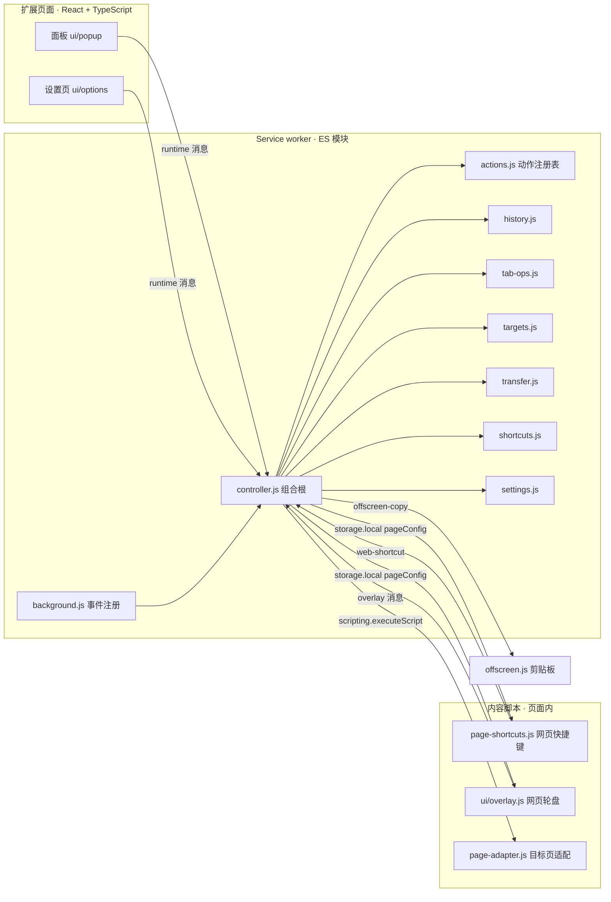
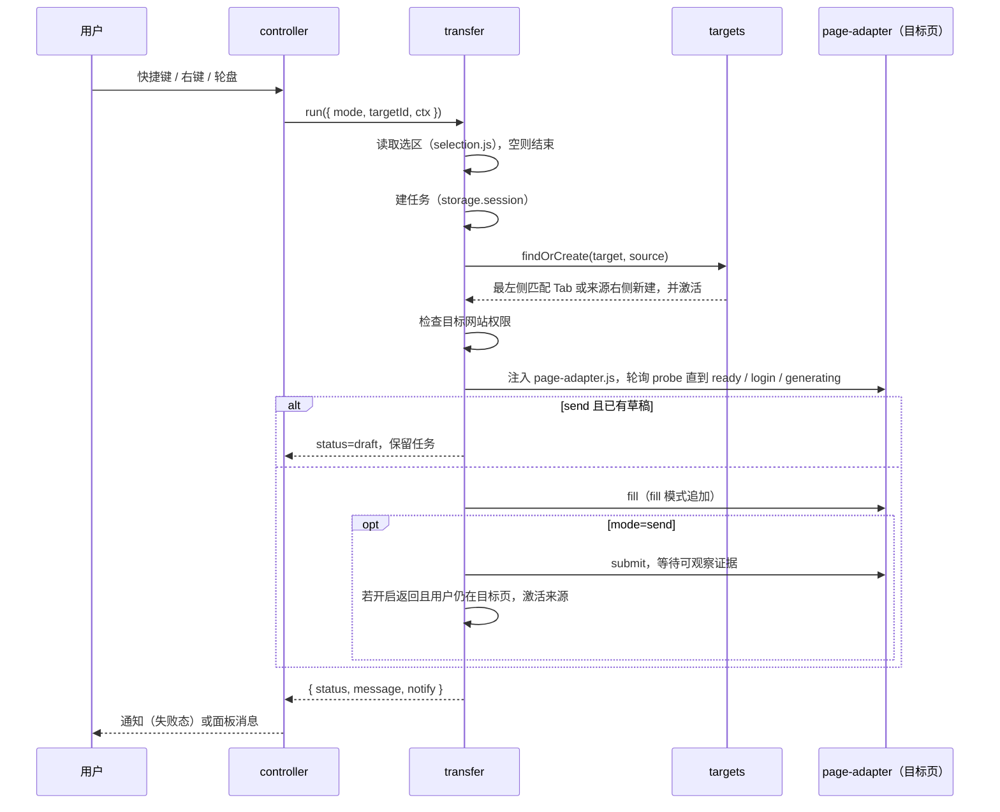

# Hiraishin 架构说明

> 面向开发者。描述代码如何组织、各层如何通信、数据存在哪里、如何构建与验证。产品目标与决策见 [PRODUCT_TECH_SPEC.md](PRODUCT_TECH_SPEC.md)；本文随代码同步更新（方案 R25）。

## 1. 总览

Hiraishin 是一个 Manifest V3 Chrome 扩展。运行时由四类上下文组成，它们只通过 `chrome.runtime` 消息和 `chrome.storage` 交换数据：



设计原则：

- **一个动作注册表，多个入口。** 快捷键、面板、右键菜单、网页快捷键、轮盘都调用 `controller.runAction(actionId, ctx)`；`ctx` 在触发时确定来源 Tab、窗口、frame 和来源类型，之后不再改变。
- **领域模块无框架、无 DOM。** `src/*.js` 是纯 ES 模块，通过注入的 `api`（即 `chrome`）访问浏览器，因此可以在 Node 中用假 Chrome 测试。
- **界面层只认消息协议。** React 页面通过 `ui/shared/api.ts` 的类型化客户端调用后台，不 import 领域逻辑；唯一例外是纯函数（按键显示、动作搜索），它们没有副作用。
- **事实与期望分开存放。** 用户配置（storage.local）、Chrome 回读的原生绑定（`commands.getAll`）、当前会话状态（storage.session）三者不混用。

## 2. 目录

```text
manifest.json              权限、20 个原生命令（与 actions.js 同源，check 脚本校验）
popup.html / options.html  仅挂载点，引用 ui/*.js 与 ui/*.css（构建产物）
offscreen.html             剪贴板离屏文档
src/                       service worker、领域模块、内容脚本（原样复制进 dist）
ui/shared/                 types.ts（后台返回结构）、api.ts（消息客户端）
ui/popup/                  面板 React 应用与样式
ui/overlay/                网页动作轮盘（独立 bundle，注入网页）
ui/options/                设置页 React 应用与样式
scripts/build.mjs          esbuild 打包 ui/，复制静态文件到 dist/hiraishin，生成 site/actions.json
scripts/check.mjs          构建 + manifest / 资源 / 语法 / 类型检查
scripts/smoke.mjs          真实 Chrome 冒烟测试（CDP）
scripts/package.mjs        打 zip
tests/                     Node 测试与 fake-chrome.js
site/                      落地页、llms.txt、robots、sitemap、actions.json（GitHub Pages）
docs/                      产品方案、本文、商店文案
```

## 3. Service worker

### 3.1 background.js

只做一件事：同步注册所有事件监听并转交 `controller`。MV3 worker 会休眠，监听必须在模块顶层同步注册，否则唤醒事件会丢失。它也过滤掉发给其他上下文的消息类型（`offscreen-copy`、`hiraishin-ping`）。

### 3.2 controller.js（组合根）

| 职责 | 说明 |
| --- | --- |
| 历史队列 | 所有历史变更经 `enqueue()` 串行执行；`onActivated` 用“预期激活标记”区分历史导航自身引起的激活（只移游标）与真实访问（追加）。标记 10 秒过期。 |
| 动作分发 | `runAction(id, ctx)`：解析上下文 → 按 `action.kind` 调用领域模块 → 统一结果 `{ status, message, notify }` → 非面板来源且 `notify` 为真时发通知。 |
| 消息边界 | `handleMessage(message, sender)`：`sender.url` 以 `chrome-extension://<id>/` 开头视为扩展页面（设置页运行在标签页里，不能用“有 tab”判断）；内容脚本只允许 `web-shortcut` 与 `overlay-state` / `overlay-action` / `overlay-confirm-action`；要求来源 Tab 处于激活状态，快捷键需匹配已保存绑定与有效 keymap，轮盘动作需属于当前分区配置。 |
| 设置变更 | `afterSettingsChange()` 串行执行：同步网页配置与脚本注册 → 重建右键菜单 → 向新注册脚本的已开页面即时注入 → 返回设置视图。设置页与权限事件可能同时触发，串行化避免重复注册。 |
| 剪贴板 | `copyText()` 经离屏文档执行 `execCommand('copy')`，需要 `clipboardWrite` 权限；调用互斥。 |
| 授权检查 | 所有真正执行操作的路径在入口检查使用资格：`runAction`（快捷键、面板、网页快捷键、网页轮盘）、右键菜单、两种轮盘批量关闭的预览与确认、`navigate` / `jump` / `close-right` 消息、任务重试。预览也检查，避免确认后才被拒。被拒不计入使用统计；`runAction` 与右键菜单返回 `license-required` 并对非面板来源发通知，其余路径抛出同一条提示。成功结果（`ok`、`navigated`、`filled`、`sent`，或 `changed: true`）交给 `license.noteResult()` 用来开始试用。设置、统计、待处理选区的查看与清除、授权消息不受限。见 [LICENSE_INTEGRATION.md](LICENSE_INTEGRATION.md)。 |

### 3.3 领域模块

| 模块 | 内容 | 纯度 |
| --- | --- | --- |
| `history.js` | 每窗口轨迹的纯函数：记录、剪裁、游标移动、ID 替换，上限 200 | 纯函数 |
| `actions.js` | 动作定义（id、名称、分类、关键词、是否原生命令、是否可网页触发、重复策略、面板输入）；自定义目标的动态动作 `target:<mode>-<id>`；搜索。AI 目标只暴露“前往”和“发送”；“填入”仅在目标无法发送时作为独立动作出现 | 纯函数 |
| `keys.js` | 组合键解析 / 规范化 / 平台转换 / 显示；`Ctrl` 为 Windows 与 Linux 的 Control，macOS 用 `Command` 与 `MacCtrl`；`reservedReason()` 给出已知被浏览器或系统占用的组合 | 纯函数 |
| `settings.js` | 设置结构、逐字段校验、v1 迁移、默认目标校验、存储封装（macOS 上把 v1 的 `Ctrl+Minus` 迁为 `MacCtrl+Minus`） | 依赖 storage |
| `tab-ops.js` | 上一 Tab（`Tab.lastAccessed`）、移动（限同固定区同分组）、指定位置、移到新窗口（重建分组、保留固定）、复制、链接文本 | 依赖 tabs / windows / tabGroups |
| `targets.js` | 内置目标（ChatGPT、Claude 的对话页 URL 规则，数组顺序即默认顺序，首位是默认目标）；`targetMark()` 给每个目标算出确定性的字母与色相、自定义目标解析、当前窗口最左侧匹配、查找或新建（同窗口同目标的并发调用共享结果） | 依赖 tabs / permissions |
| `selection.js` | 在来源 frame 读取真实选区，失败时回退到右键菜单文本，全部失败标记 `blocked` | 依赖 scripting |
| `transfer.js` | 一次传送任务的编排（见 §5），任务持久化与 30 分钟清理 | 依赖 scripting / storage / alarms |
| `shortcuts.js` | 有效 keymap（原生承接的组合被屏蔽，重复组合标记冲突）、`pageConfig` 发布、动态内容脚本注册、即时注入、原生绑定回读 | 依赖 scripting / commands |
| `notify.js` | 通知封装，只用于失败、无对象、不确定、待处理状态 | 依赖 notifications |
| `license.js` | 本地试用（首次成功动作起 14 天）、Menkyo 授权缓存与 ES256 本地验签、购买 / 领取 / 激活 / 刷新；每天一次刷新（±25% 错峰），失败退避 1h 起倍增、封顶 24h；网络与 5xx 错误不改变已购买状态，token 过期后另有 14 天离线宽限，只有服务端明确撤销才失效。服务地址与公钥在 `license-config.js`，未填写时 `npm run package` 拒绝打包 | 依赖 storage / alarms / fetch |

## 4. 消息协议

所有响应形如 `{ ok: true, ...结果 }` 或 `{ ok: false, error }`。

| 类型 | 发送方 | 参数 | 返回 |
| --- | --- | --- | --- |
| `get-state` | 面板 | `windowId` | `{ state: PanelState }`：历史、动作与绑定、目标、任务、设置、快捷键就绪状态 |
| `run-action` | 面板 | `id, windowId, args?` | 动作结果 |
| `popup-close-preview` | 工具栏轮盘 | `windowId` | `{ confirmation: { token, count } }`，不关闭标签 |
| `popup-close-confirm` | 工具栏轮盘 | `windowId, token` | 校验并消费 token，复查当前标签和候选集合后关闭 |
| `navigate` / `jump` / `close-right` | 面板 | 见 `ui/shared/api.ts` | 动作结果 |
| `get-settings` | 设置页 | — | `SettingsView`：设置、动作与绑定状态、目标与权限、命令清单 |
| `save-settings` | 设置页 | `settings` | 校验、保存后返回 `SettingsView` |
| `set-web-binding` | 设置页 | `actionId, combo \| null` | `SettingsView` |
| `sync-page` | 设置页 | — | 权限变化后重新同步 |
| `list-tasks` / `retry-task` / `remove-task` | 面板 | `taskId` | 待处理选区 |
| `web-shortcut` | 内容脚本 | `actionId, combo` | 动作结果或 `{ status: 'ignored' }` |
| `overlay-state` | 内容脚本 | — | `{ state }`：只含轮盘要画的东西（`slots`：每个分区一个动作或 null、可用性输入、平台），不含设置与标签标题 |
| `overlay-action` | 内容脚本 | `id` | 普通动作返回执行结果；`close-right` 只返回 `{ status: 'confirmation-required', confirmation: { token, count } }`；不在 `overlay.slots` 里的动作、以及需要输入的动作被拒绝 |
| `overlay-confirm-action` | 内容脚本 | `id: 'close-right'`, `token` | 消费一次性确认，再关闭预览中的标签；验证来源标签、frame、窗口、有效期和标签集合 |
| `offscreen-copy` | worker → 离屏 | `text` | `{ ok }` |
| `hiraishin-ping` | worker → 内容脚本 | — | `{ ready, active }`（仅顶层 frame 回应） |
| `get-license` | 设置页 / 面板 | — | `{ license: LicenseView }`；`get-state` 也包含 `license` |
| `start-purchase` | 设置页 | — | 向 Menkyo 取领取凭据与购买链接，保存凭据并打开链接 |
| `collect-license` | 设置页 | — | 一次领取尝试：`none` / `pending` / `revoked` / `activated`；重试由设置页有界控制 |
| `activate-license` | 设置页 | `licenseKey` | 换取并验证授权凭据 |
| `refresh-license` | 设置页 | — | 立即刷新一次 |

类型定义在 `ui/shared/types.ts`，后台返回结构改变时同步修改。

## 5. 选区传送流程



关键规则：

- 同一窗口同一目标的任务串行；不同目标互不阻塞；历史队列不受传送等待影响。
- 适配器在页面导航后会丢失（隔离世界重置），`probe` 返回 `null` 时重新注入。
- 只有“消息数增加”或“输入框在提交后清空”算已提交；否则报告 `uncertain`，绝不自动重试提交。
- 失败任务带 `failedAt`，用 `chrome.alarms` 在 30 分钟后清理；卡在 `running` 超过 5 分钟的任务在下次唤醒时清理。

## 6. 存储

设置页的 `settings-client.js` 将保存、快捷键绑定和焦点/权限刷新串行处理；每次修改都读取最新设置再应用，避免连续操作从旧的 React 状态覆盖整份配置。后台将设置写入与脚本、菜单同步放在同一队列，保证快捷键并发修改不互相覆盖。

`usage.js` 在操作发起执行时按动作和入口累计次数，不论成功或失败；打开轮盘、预览关闭确认或取消不计数，确认后的批量关闭计一次。所有入口共用后台计数服务，重试填入独立计数。统计读写与清空串行，存储失败不阻止操作；设置页展示总数、动作明细和入口汇总。当前不上传，不保存逐次事件或网页数据。

| 区域 | 键 | 内容 | 生命周期 |
| --- | --- | --- | --- |
| `storage.local` | `settings` | 用户配置（版本 2，见 `settings.js` 的 `Settings` 类型） | 长期，仅本机 |
| `storage.local` | `usageStats` | `{ version: 1, startedAt, actions: { [actionId]: { [source]: count } } }` | 长期，仅本机；设置页可清空 |
| `storage.local` | `pageConfig` | 派生：有效 keymap（含重复策略）、停用站点、轮盘配置；保留 `floating: null` 让旧版已注入按钮隐藏。内容脚本只读这一个键 | 随设置与权限变化重写 |
| `storage.local` | `license` | `{ version: 1, trialStartedAt, credential, licenseKey, token, nextRefreshAt, failures, revoked }`，只由 `license.js` 写入 | 长期，仅本机 |
| `storage.sync` | `hiraishinLicense` | `{ credential, licenseKey }` 镜像，重装或换电脑时恢复 | 随 Chrome 账号同步 |
| `storage.session` | `tabHistory` | `{ version: 1, windows: { [windowId]: { entries, cursor } } }`，只含 Tab ID | 浏览器会话 |
| `storage.session` | `transferTasks` | 传送任务：模式、目标、文本、来源、状态、时间 | 成功即删；失败保留 30 分钟 |

## 7. 内容脚本

- **page-shortcuts.js**：读取 `pageConfig.keymap`，在 `keydown` 捕获阶段匹配组合键（只响应 `isTrusted` 事件），命中后 `preventDefault` 并发 `web-shortcut`。`repeat: 'allow'` 的动作允许长按重复。站点判定以顶层 frame 的域名为准。
- **旧选区浮动按钮迁移**：不再打包或注册 `page-selection-button.js`，`shortcuts.sync()` 注销旧 `hiraishin-selection-button` 注册并发布 `floating: null`，通知尚存的旧监听器隐藏按钮；旧 `floatingButton` 偏好在规范化时丢弃，`floating-transfer` 消息不再可执行。选区发送统一使用轮盘、快捷键或右键菜单。
- **ui/overlay.js**：网页动作轮盘，唯一带打包的内容脚本（React，约 228 KB）。长按修饰键（macOS Option、其他 Alt，`resolveHoldCode` 将 `auto` 解析为 `Alt`）弹出、甩方向选中、松开或左键执行、右键或 Esc 取消，全部在封闭 Shadow DOM 里完成。修饰键长按会连发 keydown，只有第一次计时；按下任何其他键说明用户在敲真正的组合键，立即解除武装并收起面板；松开时 `preventDefault`，否则 Windows / Linux 上单独松开 Alt 会唤出 Chrome 菜单。它只认 `isTrusted` 事件，输入框聚焦时仅允许修饰键触发，字母、数字触发键不武装，`chrome.runtime.id` 消失（扩展重载）后直接不响应。默认开启；只有已启用且获得网页权限时才注册。它只注入顶层框架（`allFrames: false`，仍在 `document_start` 注入），因为画在 iframe 里的轮盘会被裁在框架内，也不必把 React 包加载进每个广告和嵌入框架；网页快捷键脚本仍注入所有框架，以便在嵌入的编辑器里也能收到按键。旧版本留下的全框架注册会在下次同步时用 `updateContentScripts` 原地收窄，已打开的页面在刷新前保持原样。未授权时设置页展示授权提示，已保存的关闭设置会保留。
- **轮盘中心提示**：快速甩动时不显示文字；在同一非空分区停留 2 秒后显示动作名称与操作提示；在圆心停留 2 秒后显示「松开取消 / 甩向某一瓣选择」。切换分区或回到圆心会隐藏提示并重新计时，关闭轮盘会清除计时，危险动作确认不受提示延迟影响。设置页预览仍直接显示所选动作。
- **轮盘动作配置**：设置页的 `WheelActionPicker` 使用共享动作图标，按分类展示并支持名称、目标缩写与关键词搜索；可用方向键选择、Esc 取消，支持留空。`WheelPositions` 从已保存的 `overlay.slots` 派生所有位置，在动作选择列表及动作表的独立位置列中显示方向箭头和位置，不添加“轮盘”前缀；重复配置显示多个位置，分区数量改变时同步更新。分区数用右栏顶部的分段按钮切换（原生单选框，方向键可切换）；减少分区时被截掉的动作在本次页面会话内记住，改回更多分区时恢复，避免一次误点丢掉配置。
- **轮盘批量关闭确认**：`Confirmation.tsx` 替换轮盘显示确认卡片，默认聚焦取消，Tab 焦点只在按钮间循环；卡片与原轮盘共用中心，空间不足时限制在视口内，尺寸和视口变化时重新定位。唤出卡片的点击被消费，避免点击穿透。Esc、点击外部、窗口失焦或标签隐藏会取消；异步状态请求返回时会检查手势版本 / 确认对象，防止取消后重新显示。后台 `overlay-action` 对 `close-right` 只生成预览，保存来源标签与 frame、窗口、候选标签 ID 和 2 分钟有效期；`overlay-confirm-action` 在队列内消费 token，候选集合变化即拒绝，执行中仍逐个复查锚点、固定状态及位置。后台重启后 token 失效，需重新确认。网页轮盘使用此流程；工具栏轮盘使用下面的 popup 确认协议。

- **page-adapter.js**：由 worker 按需注入到目标页，暴露 `globalThis.__hiraishinAdapter.run(op, payload)`，ops 为 `probe / fill / submit / focus`。ChatGPT、Claude 有内置选择器档案；自定义目标用用户提供的选择器。所有结果是可观察事实，不猜测。

这些脚本是经典脚本（非模块），注册为 `persistAcrossSessions` 的动态内容脚本；停用时既注销注册，也通过 `pageConfig` 变化让已运行实例立即失效。新注册的脚本还会立即注入到已打开的页面，免去刷新；每个标签页的注入有 3 秒上限，一个无响应的页面不能拖住触发它的那次保存——设置已经写入，该页下次加载时动态注册仍然覆盖它。

## 8. 界面层

- React 19 + TypeScript（`tsconfig.ui.json`，strict）。每个页面一个 `App.tsx`，状态用 hooks，无全局状态库。
- `ui/shared/api.ts` 是唯一的消息出口；`ui/shared/types.ts` 描述后台返回结构。
- 工具栏 popup：直接复用 `Wheel.tsx` 和轮盘样式，以 `overlay.slots` 为唯一分区配置。悬停或键盘聚焦 2 秒后显示动作及可用性，点击 / Enter / Space 执行，方向键切换焦点。页眉保留设置入口；旧动作方格、历史列表与固定动作控件已移除。历史数据仍用于后退 / 前进。只有存在失败选区任务时，轮盘下方才显示折叠的恢复入口。
- Popup 的网页手势开关与页面访问权限互相独立。分区编辑器始终显示，网页触发按键和授权说明随网页手势开关展开。旧 `pinnedActions` 仅保留存储兼容与早期配置迁移用途，不影响 popup。
- Popup 批量关闭：`popup-close-preview` 获取绑定窗口、当前标签与候选集合的短期 token，`popup-close-confirm` 消费一次性 token 并复查标签状态；内容脚本不能调用这些扩展页面消息。确认卡片复用 `Confirmation.tsx`，与圆盘共用中心，默认聚焦取消，Esc 和点击外部可取消。

- 网页动作轮盘（`ui/overlay/`）：`Wheel.tsx` 绘制 SVG 环形扇区、图标与圆心提示，`main.tsx` 管理手势。原组件尺寸为 400px，外半径 184px、内半径 80px、死区半径 40px；图标为 24px，玻璃遮罩与圆环半径保持一致，边缘定位使用同一个 `WHEEL_SIZE`。popup 按 90% 显示为 360px；设置预览按 60% 显示为 240px，窄屏按 50% 显示为 200px，容器尺寸同步。环带使用深灰半透明底色提供对比度，`.glass` 的径向遮罩只模糊环带，圆心保持清晰。扇区首尾相接，选中时着色；中心提示停留 2 秒后显示在小块深色底板上。内外圆使用亚像素描边，图标不加发光阴影。

- 设置页的轮盘不是另画一个，而是**同一个 `Wheel` 组件加同一份样式表**（`ui/options/main.tsx` 直接 `import '../overlay/styles.css'`）。`WheelSettings` 始终显示在轮盘设置项下方，因为工具栏轮盘不依赖网页手势开关。两件事让预览保持在设置区域内：外层用 `transform: scale()` 缩小，而带 transform 的祖先同时会成为固定定位后代的包含块，于是轮盘那套 `position: fixed` 不会跑出对话框；选中哪一瓣走的是手势用的同一个 `sectorAt`，所以两边对「第几瓣朝哪个方向」不可能有分歧。`backdrop-filter` 会开启自己的层叠上下文，所以刻度盘与图标必须显式 `z-index` 抬到玻璃之上，否则会被采样进模糊里。**缝隙按像素而不是按角度切**——弧长等于半径乘角度，切固定角度会让缝在圆心处窄、在外缘宽，所以 `seamAngle(r)` 用 `asin(缝宽/2/r)` 为每个半径反算该让出多少角度。**显形由鼠标移动触发**：按下即把手势「上膛」（`armed`，默认不等待，`holdMs > 0` 才计时），轮盘要等位移超过 `FLICK_START` 才出现，并以上膛那一刻的指针位置为圆心——修饰键是组合键的前半段、经常被长按，而敲组合键时手不在鼠标上，这一条就是两者的分界线，与按住多久无关。`Wheel.tsx` 还把 `sectorPath` 与 `slotPercent` 导出给设置页：设置页用同一套几何画一个小一号的轮盘来指派各方向的动作，「第几瓣朝哪个方向」因此只有一处定义。**选择由方向决定**：`sectorAt(dx, dy, count)` 用 `atan2` 把「指针相对圆心的方位」映射成扇区序号，十二点钟为 0、顺时针递增；距离只用来判断是否越过死区（`DEAD_ZONE`），从不决定选哪个，所以甩得多远、甚至甩出轮盘外都不影响判定。圆心被夹进视口且四周各留一个完整半径，保证任何方向都甩得动；因为夹取会让圆心偏离指针，打开后必须先移动一次鼠标才可能选中，否则贴边召出会凭空预选一瓣。渲染用 `flushSync`，手势在同一帧内就能把轮盘读回来。可用性判断同样抽在 `ui/shared/availability.ts`。样式以文本形式打进 bundle（esbuild `loader: { '.css': 'text' }`）并注入封闭 Shadow DOM，页面样式进不来、页面脚本也读不到。宿主元素是零尺寸锚点，遮罩与面板各自 `position: fixed`，不需要宿主铺满视口。**封闭 Shadow DOM 必须保留 `attachShadow` 的返回值**：`host.shadowRoot` 是 null，拿不到这个引用时滑选命中不到任何行。
- 设置页只有一张动作表：侧边导航与「AI 目标」「行为」两个区块都已取消，目标管理与发送行为合并到一个由「AI 目标」分组行右侧入口打开的弹窗里。表格内需要横向排布时，一律在单元格内部再套一层容器：`display: flex` 直接加在 `th` / `td` 上会让它脱离表格格式化上下文，`colSpan` 失效且同行单元格底边错位。冒烟会断言分组行横跨全表、同一行所有单元格底边齐平。
- 动作表把两件事放在一张表里完成：动作、轮盘位置、浏览器快捷键、网页快捷键各占一列。点击位置列会打开 `WheelPositionDialog`，复用 `Wheel` 选择分区；点击或按 Enter 将当前动作写入该位置（包括空分区），替换原动作并保留其他位置。取消不保存，保存失败保留对话框并提示；配置操作不会执行动作。右侧两列绑定快捷键。原来「快捷键」与「常用动作」是两个区块，却枚举同一批对象，需要来回对照。表中每行名称前是该动作的图标，AI 目标用各自的标记。两列都是同一种可点击的键位按钮（共享一条 CSS 规则并写死高度，避免两条近似规则各自漂移）：点浏览器那一列直达 Chrome 快捷键页并提示要设置哪个动作，点网页那一列打开录入对话框，悬停时右侧才出现清除的叉号。原来的“状态”列已删除，因为多数状态从两列键位即可看出；只有键位看不出的问题才就地提示：绑定了但缺网站权限、被浏览器快捷键承接、与其他动作撞键、manifest 默认键回读为空。另有“试按区”让用户验证某组合能否到达网页。
- AI 目标管理保留内置能力级别、权限申请、自定义目标 CRUD 和行为开关。
- 样式沿用 v0.1 的视觉体系（`popup.css`、`options.css`），由 esbuild 随入口一起输出；动作图标与目标标记的样式放在 `ui/shared/action-mark.css`，面板与设置页共用一份定义，面板只调整尺寸。**同一选择器在同一作用域只能声明一次**：多轮追加曾让整块规则出现第二份并静默覆盖第一份，`npm run check` 现在按 `@media` 作用域分别校验重复选择器。
- 设置页左侧导航的选中态只用背景填充与字重表示。**项目设计规则：圆角盒子禁止只在某一侧加描边**，那条边会露出圆角之外，看起来像渲染错误。需要方向性指示时，改用背景填充、或用不带圆角的独立元素画指示条。`npm run check` 会扫描两个样式表，发现同一规则里同时出现非零 `border-radius` 与单边 `border-*` 时直接失败。

## 9. 构建、测试与发布

| 命令 | 作用 |
| --- | --- |
| `npm run build` | esbuild 打包 `ui/` 为 `dist/hiraishin/ui/*.js` 与 CSS；复制 manifest、HTML、icons、`src/*.js`；生成 `site/actions.json` |
| `npm run dev` | 监听 `ui/` 变化重建；在 Chrome 加载 `dist/hiraishin` 并点“重新加载” |
| `npm test` | Node 测试：领域模块用 `tests/fake-chrome.js` 模拟 Chrome API（含激活事件时序、tab 移动、窗口创建、分组） |
| `npm run check` | 构建 → 校验 manifest 命令与 `actions.js` 一致、dist 资源存在、无内联脚本、源码语法 → `tsc` 两个配置 |
| `npm run shot` | 用 Chrome for Testing 渲染扩展页面并按 3 倍截取单个元素，默认选择器需随当前轮盘结构指定；可传页面、选择器与输出路径。`SHOT_ACTIVE=<选择器>` 通过 CDP 强制真实的 `:active` 状态，`SHOT_PRE=<JS>` 可先布置页面状态 |
| `npm run smoke` | 用 Chrome for Testing 验证核心交互：历史与标签操作、剪贴板、fixture 目标传送与草稿保护、快捷键与轮盘、危险操作确认、设置保存与本地统计 |
| `npm run package` | check 后打 `dist/hiraishin-<version>.zip` |
| `npm run try [-- local] [-- --fresh]` | 构建后只把 `dist/` 里的授权配置指向 Menkyo 测试环境（默认）或本地 Menkyo，并用 Chrome for Testing 打开设置页供手动测试购买与激活；浏览器配置保存在 `.artifacts/try-profile-<env>`，`--fresh` 清空。源码 `src/license-config.js` 保持正式值 |
| `npm run site:deploy` | 把 `site/` 发布到 `hiraishin.44san.com`（Cloudflare 静态资源） |

`dist/hiraishin` 是唯一的加载与发布目录；仓库根目录不能直接作为扩展加载。

测试按职责分工：单元测试覆盖边界条件、权限、竞态、计数规则；`check` 负责构建、类型与资源一致性；冒烟验证真实浏览器交互及误触保护，不重复枚举纯逻辑组合。外观尺寸、配色和图标对齐用截图复核，提示延时在相关改动时手动检查。日常运行相关单元测试与 `check`，浏览器交互改动和发布前再运行冒烟；AI 的 fixture 测试不替代真实登录页验收。

冒烟测试默认**有头**运行。无头渲染进程在被派发输入事件后会停止响应 DevTools 协议（连新建的调试会话都连不上），把整套测试拖成永久挂起；同一套断言在有头模式下全绿。`HEADLESS=1 npm run smoke` 仍可强制无头，但网页内动作面板那一节在那里跑不了。另外两条硬性约定：每个协议调用都有超时、整轮有看门狗，卡住必须表现为一条有名字的失败；消息统一由 service worker 里的测试钩子发出，不经过扩展页面——后台化的扩展页会停止执行，而所有扩展页共用一个渲染进程，一个卡住会连累其余（真实的 popup 失焦即关闭，不存在这种状态）。

## 10. 扩展点

- **新增动作**：在 `actions.js` 定义 → `controller.runAction` 增加 `kind` 分支 → 在 `ui/popup/icons.tsx` 为新的 `kind` 添加图标 → 如需原生命令，`manifest.json` 加同名命令（check 会校验顺序一致）→ 附录 A 与 `site/actions.json` 自动同步。
- **新增内置目标**：`targets.js` 的 `BUILTIN_TARGETS` 加 URL 规则与 `site`，`page-adapter.js` 加选择器档案，`actions.js` 自动生成三种动作。
- **收费方案**：完整试用后一次性购买，授权由 Menkyo 发放，见 [LICENSE_INTEGRATION.md](LICENSE_INTEGRATION.md)。不做功能分层；旧配置中的 `plan` 字段在规范化时丢弃。**新增会执行操作的入口时，必须在入口调用授权检查**，并在 `tests/license.test.js` 的全入口测试里加上这一条。
- **新增页面消息**：在 `controller.handleMessage` 加分支，同时更新 `ui/shared/types.ts`、`ui/shared/api.ts` 与本文第 4 节。
