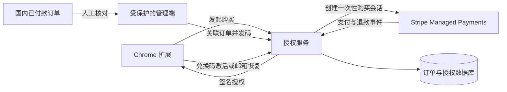

# Hiraishin 试用、支付与授权方案

> 更新：2026-09-25。状态：收费方向已确认，具体参数与技术选型待定，尚未实现或接入真实收款。
>
> 本文记录拟采用的方案，不代表当前扩展已经收费，也不改变现有用户的使用权限。

## 1. 已确认的方向

采用 **完整功能试用 → 一次性购买 → 解锁整个扩展** 的方式。

| 事项 | 方案 |
| --- | --- |
| 收费方式 | 一次性购买，不自动续费 |
| 试用范围 | 完整体验已实现的功能 |
| 功能划分 | 不拆 Free / Pro，不按自定义目标数量或动作类型收费 |
| 海外收款 | 使用 Stripe Managed Payments，面向其支持的买家地区 |
| 国内收款 | 独立销售渠道，首版人工核对订单、发送兑换码 |
| 授权系统 | 所有渠道共用一套授权，同一扩展、相同功能 |
| 恢复购买 | 通过购买或兑换时绑定的邮箱验证身份 |
| 支付服务 | 不使用 ExtensionPay |

售价、试用天数、设备数量和后续版本权益仍需确定，见第 9 节。一次性付款不自动等同于承诺所有未来大版本免费。

## 2. 收款渠道与职责

### 2.1 海外：Stripe Managed Payments

Stripe 官方支持软件类数字商品及一次性付款。Managed Payments 承担其覆盖地区的间接税处理、欺诈防范、争议处理和交易相关客服；产品功能、使用指导与授权问题由我们处理。[适用范围](https://docs.stripe.com/payments/managed-payments) · [一次性付款接入](https://docs.stripe.com/payments/managed-payments/set-up)

截至本文更新日期：

- 官网标准费用为常规 Stripe 支付手续费 **额外加 3.5%**，没有设置费或月度最低费用；实际成本还需按账户地区、支付方式和其他适用费用核算。[定价说明](https://stripe.com/managed-payments)
- 日本、香港、新加坡等商户所在地在支持名单内，账户能否开通仍需 Stripe 审核；当前商户账户所在地及开通资格尚未核实。
- 官方将 China 列为受限买家地区，中国大陆订单通过另外的收款渠道承接。[资格与地区限制](https://docs.stripe.com/payments/managed-payments/eligibility)
- Stripe 支持按市场、产品或交易选择性启用 Managed Payments，允许我们采用多渠道方案。其代管职责不覆盖独立国内渠道的订单。[混合使用说明](https://stripe.com/managed-payments)

建议采用 Stripe 托管 Checkout，由自己的后端创建一次性购买会话，使用 `mode: payment` 和 `managed_payments.enabled: true`。不为买断产品创建订阅，也不使用订阅试用来实现扩展试用。[接入文档](https://docs.stripe.com/payments/managed-payments/set-up)

### 2.2 国内：候选销售渠道 + 兑换码

闲鱼、小红书是候选渠道，**尚未确认飞雷神软件授权码可在具体卖家账号下上架**。正式采用前核实可售类目、账号资质、数字商品交付与退款规则。闲鱼协议要求发布行为符合相应规则，部分经营类别需要认证；这不构成软件授权码已获准销售的结论。[闲鱼用户服务协议](https://terms.alicdn.com/legal-agreement/terms/suit_bu1_other/suit_bu1_other201708081618_51146.html)

首版采用人工流程：从实际订单核实付款 → 在管理端关联订单并生成兑换码 → 通过渠道允许的方式交付。核实依据是渠道订单状态，不是买家提供的付款截图。

暂不接入各平台的自动订单同步、自动聊天或自动发货。后续增加渠道时，只需把已付款订单接入统一的授权发放流程。国内订单的收款、退款和相关税务另行安排。

## 3. 用户体验

### 3.1 完整试用

以下为建议细则，尚未作为正式销售条款确定：

- 暂按 **14 天**设计，最终期限待定。安装时说明试用期与买断价格，无需绑卡，不自动扣费。
- 建议从第一次成功执行扩展动作开始计时。网页轮盘、工具栏轮盘、快捷键和右键入口统一计算，避免只用某个入口时永不开始试用。
- 打开设置、只唤出轮盘、取消操作、执行失败或无实际效果的操作不开始计时。
- 首版建议匿名、本地计时，以降低首次使用门槛；清除扩展数据、重装或修改本机时间可能绕过它，不把它描述成严格防重复试用。
- 若以后需要严格限制重复试用，再采用邮箱验证和服务端计时；不采用硬件指纹来弥补本地计时的限制。
- 到期后暂停新的动作执行，保留用户设置、查看配置、购买、激活与恢复购买入口。已有待处理内容仍可按原保留期限查看和复制，不因试用到期提前删除。
- 不在手势中途突然弹出购买网页。剩余时间和购买入口放在 Popup / 设置页，到期时给出明确反馈。

### 3.2 海外购买

1. 用户在扩展中点击“一次性购买”，后端创建与当前安装关联的购买会话。
2. 打开 Stripe 托管收银台，展示商品、金额及税费。
3. 后端收到支付事件，验证来源并确认订单已付款，幂等创建完整授权。
4. 扩展凭绑定的购买会话查询结果，获取授权并自动开通。用户关闭收银台或错过成功页，不影响已付款订单后续恢复。
5. 将订单邮箱记录为恢复购买的身份；恢复时必须验证邮箱控制权，不能只输入邮箱就获得授权。

支付完成通知可能存在延迟。界面可以显示“正在确认付款”，但不能把成功页 URL、前端参数或公开订单编号作为已付款凭据。Stripe 要求用服务端事件可靠处理支付后的交付，并处理延迟支付方式。[支付后事件](https://docs.stripe.com/payments/managed-payments/set-up#handle-post-payment-events)

### 3.3 国内购买与激活

1. 用户通过已确认可用的国内渠道购买软件授权。
2. 运营核实实际付款订单，为该订单生成唯一兑换码并交付。
3. 用户打开扩展设置，选择“使用兑换码”，输入兑换码和邮箱并完成邮箱验证。
4. 后端核对兑换码状态，将其一次性兑换为绑定该邮箱的完整授权。
5. 扩展保存授权，立即恢复使用；用户不需要重设轮盘和快捷键。

兑换码是首次领取授权的凭据。一个码只能绑定一个身份；重复兑换请求不重复创建授权；同一用户重装后走“恢复购买”，不消耗新码。未兑换码可以作废并补发，已兑换授权需核实订单和身份后处理。

### 3.4 恢复购买与离线使用

- 用户输入购买或兑换时绑定的邮箱，通过短期验证码或邮件链接验证后恢复授权；不要求提供 Stripe、闲鱼或小红书的登录凭据。
- 支持换浏览器配置或重装后的恢复。允许同时使用的安装数量及自助解绑规则待定，不预设单设备限制。
- 第一次激活或恢复需要联网。已激活用户使用本地缓存，后台刷新授权，不在每次轮盘手势前联网。
- 区分“网络暂时不可用”和“服务端明确撤销授权”，不能把请求失败当作未购买。
- 购买资格与本地验证缓存的有效期分开。缓存刷新周期、最长离线时间和故障宽限期待定；退款撤销在离线设备上无法实时生效。

## 4. 统一授权架构（建议）

授权服务拥有订单、兑换码与授权状态；扩展持有已验证的使用凭据。收款渠道是订单来源，不决定用户能使用哪些功能。

### 4.1 职责边界

| 部分 | 负责内容 |
| --- | --- |
| 扩展 | 展示试用状态与购买入口、激活和恢复、缓存授权、统一判断能否执行动作 |
| 授权服务 | 创建购买会话、确认支付、发放或撤销授权、兑换码、邮箱验证、恢复购买 |
| 数据库 | 记录订单来源、付款结果、兑换状态、授权归属和必要操作记录 |
| 邮件服务 | 发送身份验证与恢复购买邮件，不承担付款成功的事实判断 |
| 管理端 | 查询订单、核实国内付款、发码、补发、处理退款与授权问题 |

后端托管平台、数据库与邮件供应商尚未选定。本方案不要求引入特定云厂商，也不引入订阅或功能分层框架。

### 4.2 最小数据模型

| 对象 | 建议保存的信息 |
| --- | --- |
| 用户身份 | 内部 ID、邮箱、验证状态 |
| 订单 | 渠道、外部订单 ID、商品、金额与币种、付款及退款状态 |
| 购买会话 | 与安装关联的短期凭据、对应订单、过期时间；不能仅凭公开 ID 领取授权 |
| 兑换码 | 高强度随机码的校验摘要、关联订单、未兑换 / 已兑换 / 作废状态、兑换身份与时间 |
| 授权 | 内部 ID、归属身份、关联订单、完整产品的使用权、有效或撤销状态 |
| 安装实例 | 随机安装 ID、授权关联、最近验证时间；不采集硬件指纹 |

邮箱验证凭据另行短期保存，限制使用次数和有效期。服务端不记录浏览历史、网页 URL、选中文字或聊天内容来判断购买资格。

### 4.3 发放、校验与撤销

- Stripe 密钥、Webhook 验签密钥和授权签名私钥只保存在服务端。扩展只持有校验所需的公钥及自己的有限权限凭据。
- 支付事件验证签名，并核对商品、付款状态与订单关联。按渠道与外部订单 ID 防止重复发放；事件乱序时重新核对实际状态，已退款订单不能被迟到的成功事件重新开通。
- 兑换操作使用数据库原子更新，防止同一兑换码被并发领取。兑换码不携带客户端可自行信任的“已购买”标志。
- 邮箱恢复接口和兑换接口需要请求频率限制；管理端只能由授权运营人员访问。
- 已确认的全额退款按销售条款撤销相应授权。部分退款和争议中的订单根据待确定的政策处理，不能把所有争议通知直接等同于最终退款。
- 国内退款由运营同步到授权系统；Stripe 退款通过事件同步。撤销在客户端下一次有效校验或缓存到期时落实，具体离线政策见第 9 节。

这些机制用于控制授权发放和普通滥用。扩展在用户设备上运行，不能承诺彻底防破解。

## 5. 扩展接入范围（建议）

当前尚未实现以下改动：

- 新增独立的试用与授权状态模块，通过现有后台消息向 Popup 和设置页提供状态；不把许可签名或支付密钥放进用户可编辑的设置字段。
- 区分未开始、试用中、已到期、已购买、已撤销；网络失败作为校验情况单独记录，不覆盖已验证的购买事实。
- 授权判断覆盖所有会产生实际操作的入口：网页 / 工具栏轮盘、原生 / 网页快捷键、右键菜单、任务重试，以及确认后执行危险操作的路径。
- 现有 `runAction` 并未覆盖所有直接调用路径，实施时同时检查 `controller` 内的确认、历史导航和旧消息路由；不能只禁用界面按钮。
- 保留查看和修改配置、激活、恢复购买及待处理内容恢复入口；到期后不删除配置。
- 更新真正涉及支付的数据说明与隐私政策。授权所需邮箱、订单和安装信息与原本的本地浏览数据分开说明。
- 对外销售文案只展示最终确定的价格、试用和购买权益，不提前宣传未定的设备上限或终身更新承诺。

## 6. 首版运营范围

先完成 Stripe 自动开通和国内人工发码，使用同一套授权系统。管理端的最小范围是：按订单 / 邮箱查找、核对订单、生成和补发兑换码、查看兑换状态、同步退款与撤销。

暂不做代理分销、批量优惠、团队席位、自动对接多个国内平台、订阅续费、功能等级或云同步收费。未来需求另行讨论。

## 7. 实施顺序

| 阶段 | 交付结果 |
| --- | --- |
| 1. 确定销售条款 | 明确第 9 节参数，核实 Stripe 资格和一个国内渠道 |
| 2. 建立授权基础 | 邮箱验证、订单与授权记录、兑换与恢复流程；先使用测试订单 |
| 3. 接入 Stripe 测试环境 | 一次性 Checkout、支付通知、幂等发放、退款同步 |
| 4. 接入扩展 | 试用状态、全入口授权检查、本地缓存、购买和恢复界面 |
| 5. 建立国内人工流程 | 真实订单核对、发码、补发、退款和售后记录 |
| 6. 验收后启用正式收费 | 完成关键用例，公布销售条款，明确处理老用户，再开通生产收款 |

本文不授权直接对现有用户开启试用倒计时或收费限制；当前任务只形成方案文档。

## 8. 验收重点

| 场景 | 预期结果 |
| --- | --- |
| 新安装、只查看界面、首次成功动作 | 按确定的试用起点计时，各动作入口一致；重复成功操作不重置起点 |
| 重启后台、重启浏览器 | 试用与已验证购买状态不丢失 |
| 试用到期 | 停止新的动作执行，保留设置和内容恢复入口；没有绕过检查的入口 |
| 支付取消、失败、延迟确认 | 不提前发放授权，不误报购买成功 |
| 付款成功后关闭页面或断网 | 服务端仍记录授权，之后可正常领取或恢复 |
| 重复或乱序支付通知 | 一笔订单只生成一份有效授权，不复活已撤销授权 |
| 无效、已兑换、作废兑换码 | 明确反馈，不覆盖已有有效授权；并发兑换只绑定一个身份 |
| 同一邮箱恢复、错误邮箱或伪造购买回调 | 只有持有有效身份或购买凭据的一方能取得授权 |
| 已购买用户短暂离线、服务器故障 | 按缓存与宽限政策继续使用，不因网络错误变成未购买 |
| 全额退款及已离线客户端 | 服务端状态正确撤销；客户端按已说明的校验期限落实 |
| 老用户升级、换电脑 | 符合确定的迁移和设备政策，不悄悄清除配置或强制重新购买 |

## 9. 待确定事项

| 事项 | 当前状态 |
| --- | --- |
| 试用期限 | 暂按 14 天设计，未最终确定 |
| 试用起点与防重复强度 | 建议首次成功动作开始、本地匿名计时，接受可重置限制；待确定 |
| 售价与币种 | 未确定；国内外价格、含税展示方式分别确认 |
| 购买覆盖的版本与后续更新 | 未确定，不默认承诺所有未来版本免费 |
| 同时使用的安装数量 | 未确定，不默认限制为一台设备 |
| 离线使用政策 | 缓存刷新、最长离线时间及服务故障宽限期限未确定 |
| 老用户政策 | 未确定；不能直接套用新用户到期规则 |
| 退款及争议处理 | 期限、部分退款和争议期间的授权状态未确定；与所用渠道规则一致 |
| Stripe 商户账户 | 所在地区、资格审核及 Managed Payments 开通状态未核实 |
| 国内销售渠道 | 闲鱼、小红书为候选，具体类目与账号资格未核实 |
| 后端与邮件服务 | 尚未选定；需覆盖目标用户的网络访问与邮件送达 |

实施时可以先用可配置参数在测试环境验证。正式收费前将这些事项写成明确的用户条款，避免把研发默认值当作销售承诺。
