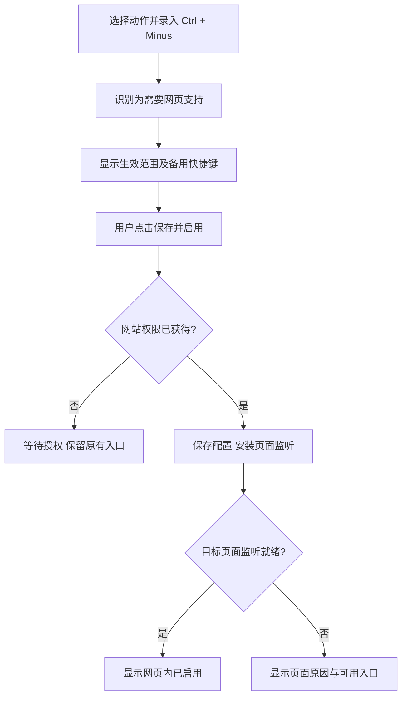
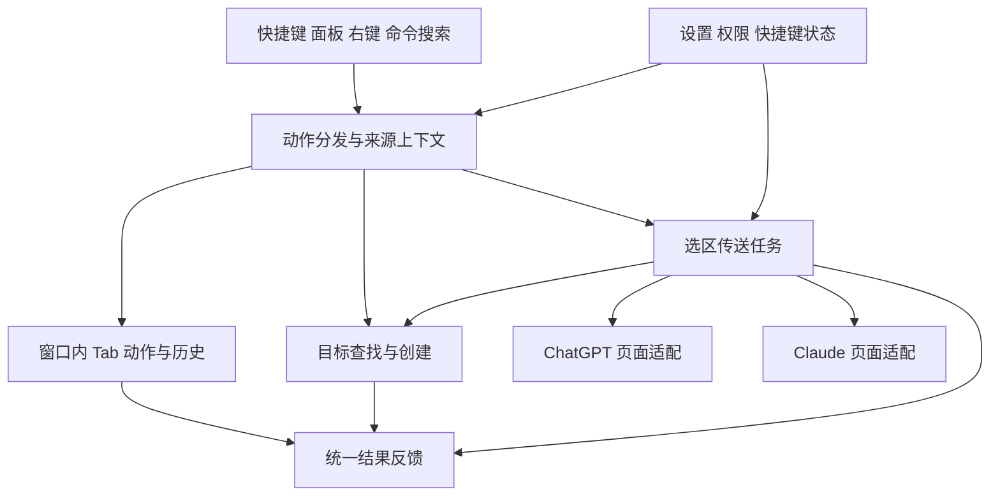

# 飛雷神 Hiraishin · 产品与技术方案

> 版本：v0.12 · 合并用户第九批反馈：设置页只剩动作表，AI 目标与行为进弹窗  
> 整理日期：2026-09-15  
> 目的：明确首发功能、默认行为和技术方案，作为后续实现依据。  
> 状态：用户已明确核心选择，其余常规决策采用本文默认值。目标能力的实现状态见第 10 节。

> **发布版本说明（2026-09-25）**：本文包含历次方案与决策演进，不是当前商店功能清单。0.2.0 已以网页 / 工具栏轮盘为主入口，移除了 popup 历史列表与选区浮动按钮。当前用户行为以 [README](../README.md) 为准；发布状态见 [上线审查](RELEASE_REVIEW.md)。后文未来商业化方案不构成当前产品承诺。

## 阅读方式

- **已确认**：用户明确提出或明确选择的方向。
- **默认决策**：根据用户“其余自己判断”的授权确定的行为，直接作为当前方案执行。
- **后续候选**：已讨论但明确留在首发之后的扩展方向。
- **现状**：当前原型或已有插件的实际行为，不自动成为最终产品要求。
- **技术边界**：基于 Chrome 公开能力确认的限制。

建议先阅读第 3 节的首发范围、第 6 节的快捷键方案，以及第 13 节的决策记录。技术设计集中在第 7–10 节。

**本次评审结论：**首发覆盖前面讨论的 Tab 操作、AI 直达与选区传送、统一快捷键；AI 目标固定为当前窗口最左侧匹配项；发送后行为参考 Unten，默认停留、可开启返回；AI 跳转及自动返回都进入访问历史。其余产品默认值已在正文落实，常规设计不再逐项请求确认。

**v0.3 补充：**第二轮评审指出的缺口已按授权形成默认决策并写入正文：AI 适配可行性前置为步骤 0、结果反馈渠道、选区读取方式、网页快捷键可触发的动作范围、内置目标 URL 规则、上一 Tab / MRU 数据来源、原生命令清单、失败选区到期清理、界面语言与分发。汇总见第 13 节 R13–R23 与附录 A。

**v0.4 用户反馈：**界面改用 React + TypeScript，并引入构建；交付必须包含架构文档（[ARCHITECTURE.md](ARCHITECTURE.md)）；传播、SEO / GEO 与商业化从第一天纳入方案，见第 14、15 节与 R24–R27。

### 快速导航

- 产品：[方向与共识](#1-产品方向与共识) · [需求验证](#2-需求线索与验证方式) · [功能地图](#3-功能地图与范围)
- 体验：[入口与核心行为](#4-用户入口与核心行为) · [目标选择](#5-目标网站与-ai-tab-选择) · [快捷键](#6-快捷键与渐进式增强) · [AI 传送](#7-ai-选区传送)
- 技术：[架构](#8-技术架构) · [数据与权限](#9-数据权限与能力启用) · [现有资产](#10-现有资产与整合边界)
- 落地：[验收](#11-验收与体验指标) · [实现顺序](#12-首发实现顺序) · [决策记录](#13-决策记录) · [附录 A 命令清单](#附录-a原生命令清单)
- 战略：[传播与被发现](#14-传播与被发现seo--geo) · [商业化](#15-商业化路径)

## 1. 产品方向与共识

### 1.1 已确认的方向

1. 产品名称为 **飛雷神 Hiraishin**，形态为 Chrome 扩展。
2. 初期从 Tab 出发，逐渐加入日常真正需要的小功能。
3. 支持类似 VS Code 位置历史的 Tab 访问轨迹前进、后退。
4. **Tab 访问历史按窗口独立记录**。
5. 支持关闭当前 Tab 右侧的标签页。
6. 希望保留 `Ctrl+-` / `Ctrl+Shift+-` 的使用习惯，并通过渐进式增强改善兼容性。
7. 希望在 Hiraishin 的设置页管理快捷键，与 Chrome 原生快捷键保持一致的显示和使用体验；可行范围见第 6 节。
8. 希望整合已有的 Unten 和 Tab Controller 能力，加入 ChatGPT / Claude 定向跳转、选区填入与发送，以及复制 Tab。
9. 当前完成文档修订；已有原型是讨论参考，后续功能和行为以本文为依据。文档确认不代表新增功能已经实现。
10. AI 目标取当前窗口最左侧匹配 Tab；AI 操作造成的跳转和返回正常进入该窗口访问历史。
11. 发送后行为参考 Unten：默认停留在目标页，提供“发送后返回来源页”开关。

### 1.2 产品定位

**从 Tab 出发，让日常浏览器操作更顺手的工具箱。**

将能力围绕三件事组织：

- 操作 Tab：切换、移动、复制、整理。
- 到达目标 Tab：前往刚访问的页面、指定网站或某个 AI 对话。
- 将内容送到目标 Tab：把当前选区交给 ChatGPT、Claude 等页面处理。

代表性工作流：

> 阅读文档 → 选中文字 → 发送给 Claude → 返回文档继续阅读 → 一键前往 Claude 查看回答。

产品希望形成的感受是：**用户知道如何触发，也知道触发后会发生什么。**

### 1.3 初期用户假设

首先满足作者自己的高频需求，再寻找工作方式相近的用户验证。候选人群是经常在多个网页与 AI 工具之间切换、重视键盘操作的开发者、研究者及其他知识工作者。

以上是目标用户假设，目前没有客户访谈或使用数据足以证明市场规模、付费意愿或功能普遍性。

## 2. 需求线索与验证方式

### 2.1 已有需求线索

| 线索 | 能说明什么 | 不能据此推断什么 |
| --- | --- | --- |
| 作者已经为 Tab 移动和选区发送分别制作插件 | 这些问题至少在作者的实际工作中重复出现 | 所有用户都需要同样的操作和默认值 |
| 有用户明确寻找“关闭右侧 Tab”和“复制 Tab”的自定义快捷键 | 存在将浏览器动作快捷化的具体需求 | 单个帖子能代表需求规模 |
| CMU 关于 Tab 使用的研究 | Tab 常承担资料存放、任务提醒和工作组织等用途 | 2021 年研究可以直接代表当前所有浏览器用户 |
| 会话工具中出现保存内容丢失、导入失败的用户反馈 | 一旦承诺保存工作现场，恢复可靠性会成为重要要求 | Hiraishin 初期必须实现完整会话管理 |

参考：[快捷键需求讨论](https://www.reddit.com/r/chrome/comments/1qfbdiq/need_chrome_extension_to_close_tabs_to_the_right/)、[CMU 研究介绍](https://hcii.cmu.edu/news/overcoming-tab-overload)、[会话保存问题反馈](https://github.com/sienori/Tab-Session-Manager/issues/1625)。这些资料是定性线索，尚未开展系统竞品评估。

Chrome 已提供 Tab 搜索、分组、移动和批量操作。Hiraishin 的机会包括更快触达这些动作、提供一致的配置方式，以及将动作连接成工作流。[Chrome Tab 管理说明](https://support.google.com/chrome/answer/2391819)

### 2.2 待验证的痛点

| 用户当时的想法 | 候选能力 |
| --- | --- |
| “刚才那个页面在哪？” | 历史导航、上一 Tab、最近使用列表 |
| “这个动作有，但每次执行很麻烦。” | 自定义快捷键、统一动作入口 |
| “查到一段内容，想立即交给 AI。” | 选区填入与发送、发送后返回 |
| “ChatGPT 开了好几个，不知道会发到哪个。” | 明确的目标选择规则、指定对话 |
| “这部分工作结束了，把这一批页面收起来。” | 关闭、移动一批 Tab，后续探索撤销 |
| “快捷键设置好了，却有时没反应。” | 真实生效状态、覆盖范围说明、诊断与备用入口 |

### 2.3 建议的需求验证流程

1. **个人操作日志**：连续一周记录“正在做什么 → 想完成什么 → 当前怎么做 → 麻烦在哪里 → 重复频率”。
2. **小规模定性访谈**：邀请 5–8 位工作方式相近的用户，演示最近一次遇到的问题与现有替代方法。
3. **带任务试用**：给出实际场景，观察用户能否发现功能、完成设置、成功触发，并在之后继续使用。
4. **需求卡片**：每项需求记录场景、证据、频率、打断程度、现有替代方案、可靠实现的成本与待验证假设。
5. **排序**：优先处理反复出现、有明确替代成本、能够稳定交付的动作。

6. **用户反馈**：上架后的需求主要来自 44san 的通用反馈服务（各产品共用，按产品区分），用户主动填写的内容才会被提交；扩展只在链接里带上产品、版本和界面语言，便于归类。

建议关注首次成功操作、每周重复使用、执行失败、快捷键配置放弃，以及误操作后的恢复情况。初期可使用个人本地统计和访谈；当前未实现远程统计或账户体系，商业化规划见第 15 节与 [支付与授权方案](PAYMENT_PLAN.md)。

## 3. 功能地图与范围

### 3.1 功能地图

| 编号 | 模块 | 功能 | 讨论状态 |
| --- | --- | --- | --- |
| F01 | 穿梭 | Tab 访问历史后退 / 前进，按窗口独立 | 首发；用户确认，已有原型 |
| F02 | 穿梭 | 切回上一 Tab | 首发；数据来源见第 4.2 节。最近使用列表按 v0.6 反馈移出首发，见 F15 |
| F03 | 整理 | 关闭当前 Tab 右侧标签页 | 首发；用户确认，已有原型 |
| F04 | 整理 | 左移、右移、移到首尾或指定位置 | 首发；整合 Tab Controller 能力 |
| F05 | 整理 | 当前 Tab、当前连同左侧 / 右侧 Tabs 移到新窗口 | 首发；整合 Tab Controller 能力 |
| F06 | 复制 | 复制标签页，即 Duplicate Tab | 首发；用户提出 |
| F07 | 直达 | 打开或切换到当前窗口最左侧 ChatGPT / Claude Tab | 首发；用户确认 |
| F08 | 传送 | 将选中文字填入并自动发送到 AI 页面 | 首发；整合 Unten 能力 |
| F09 | 传送 | 区分前往与发送两个动作；仅填入只在目标无法发送时提供，见 R32 | 首发；v0.8 按反馈收紧 |
| F10 | 配置 | 统一快捷键设置、按需网页增强、原生状态回读 | 首发；用户提出的目标，遵循平台边界 |
| F11 | 直达 | 自定义目标 URL 与输入框选择器 | 首发；延续 Unten 配置能力；最近使用目标与指定 Tab 绑定留在后续 |
| F12 | 入口 | 常用动作固定、全部动作搜索、相关右键菜单 | 首发；默认决策，搜索集成在工具面板 |
| F13 | 带走 | 复制一个或多个链接、复制为 Markdown | 首发；默认决策，与复制标签页分别命名 |
| F17 | 入口 | 网页动作轮盘：长按修饰键弹出径向菜单，甩向某个方位选中并执行 | 首发；用户决定（R43 / R44 / R45），默认开启，首次需授权网页访问 |
| F14 | 扩展 | 选区翻译 / 解释等提示词模板 | 后续候选 |
| F15 | 扩展 | 最近使用列表、临时返回点、关闭其他 Tab、查找发声 Tab、移动到已有窗口 | 后续候选 |
| F16 | 扩展 | 任务现场保存、完整会话恢复、批量操作撤销 | 后续探索，需单独验证恢复边界 |

表中“整合 Unten / Tab Controller 能力”指延续已讨论的产品能力，不表示将原仓库代码直接复制进当前项目，也不表示兼容性已验证。

### 3.2 首发范围

首发覆盖前面讨论的完整核心功能，即 F01–F13：

- **Tab 操作**：历史导航、上一 Tab、移动、复制、关闭右侧与复制链接。
- **AI 与目标网站**：ChatGPT / Claude 直达，自定义目标 URL 与选择器，选区填入 / 发送，以及可选发送后返回。
- **统一入口与设置**：动作面板、搜索和常用固定、右键与快捷键、网页增强、原生绑定状态回读；选区发送使用轮盘、右键菜单或快捷键。
- **后续功能池**：前文明确作为扩展探索的提示词模板、临时返回点、完整会话保存等 F14–F16，以及更多目标选择策略。

实现可以按模块先后推进，但 AI 直达和选区发送属于同一个首发范围。内部开发顺序见第 12 节。

### 3.3 功能增长规则

个人需求可以先进入实验功能；默认界面只展示少量高频动作。新增功能应能回答：作用对象是谁、在哪里可用、如何触发、执行结果是什么、失败后怎么办。

**扩展方式（2026-10-16 决定）**：用户通过反馈入口提出需求，开发者把它做成可勾选、可配置的动作。

- **入口**：设置页底部、官网和商店描述放「想要什么功能」，指向 44san 的通用反馈服务（见第 2.3 节）。扩展本身不上报任何数据。
- **门槛**：同一需求被多人提出，或一个动作能覆盖一类需求，才进入动作注册表；其余记为需求卡片。
- **参数化优先**：同一种动作换参数的需求（如带不同提示词发送到不同目标、打开带变量的网址、按模板复制）做成一种可配置的动作类型，用户在设置页填参数，不逐个新增动作。

## 4. 用户入口与核心行为

### 4.1 入口设计

| 入口 | 用途 | 行为原则 |
| --- | --- | --- |
| 快捷键 | 高频、已经形成习惯的动作 | 一次触发执行一个明确动作 |
| 工具面板 | 发现功能、点击常用动作、查看当前状态 | 显示当前可操作内容；不可用时说明原因 |
| 独立设置页 | 配置动作、快捷键、目标网站 | 配置期望与实际生效状态分别展示 |
| 右键菜单 | 对选中文字执行相关操作 | 只展示与当前上下文有关的动作 |
| 命令搜索 | 查找所有功能 | 首发集成在工具面板内，支持动作名和关键词搜索 |
| 选区发送 | 选中文字后快速发送 | 使用轮盘、右键菜单或快捷键，不显示选区浮动按钮 |
| 网页动作轮盘 | 不打开工具面板、也不占用快捷键就能执行动作 | 按住 Option（Windows / Linux 为 Alt）并甩动鼠标弹出轮盘，松开或左键执行，危险操作需确认，右键取消；默认开启，首次需授权网页访问 |

所有入口应调用相同的动作实现。操作开始时确定来源 Tab、窗口和选区，不能因为随后打开面板或切换焦点而误用另一个对象。

### 4.2 历史、上一 Tab 与 MRU

| 概念 | 定义 | 示例 |
| --- | --- | --- |
| 访问历史 | 保留实际访问轨迹，用游标前进 / 后退 | 访问 A → B → C → A，后退依次到 C、B、A |
| 切回上一 Tab | 反复切换当前和上一次使用的 Tab | A 与 C 之间往返 |
| 最近使用列表（MRU） | 按最近使用排序，每个打开的 Tab 通常只出现一次 | 上述访问后列表为 A、C、B |

用户最初描述的 VS Code 式操作对应访问历史。界面应使用“访问历史后退 / 前进”，避免用一个“MRU”名称覆盖三种不同预期。

**上一 Tab 与 MRU 的数据来源（默认决策）：**

- 两者都由 Chrome 返回的 Tab 最近激活时间（`Tab.lastAccessed`）实时计算，不另行存储，也不受访问历史 200 条上限和“扩展启用后才开始记录”的限制。该字段需要 Chrome 121，最低版本随之从 120 提升到 121。
- “切回上一 Tab”激活当前窗口中最近激活时间次新的 Tab。它不是历史导航：每次切换都是普通激活，按实际顺序进入访问历史，反复切换形成 A → B → A → B 的真实轨迹。
- MRU 列表这个概念保留下来，只为在文档里区分三种不同预期；按 v0.6 反馈它不在首发界面中提供，移入 F15 后续候选。

**历史行为，部分已由原型实现：**

- 每个窗口独立记录；同一 Tab 的非连续重复访问保留。
- 历史前进 / 后退只移动游标，不新增访问记录。
- 从 C 后退到 B，再手动访问 D，轨迹变为 A → B → D。
- 到达边界停留，不循环跳转。
- 已关闭或移出窗口的 Tab 从该窗口轨迹移除。
- 点击历史项前确认它仍对应原 Tab，避免列表变化后跳错对象。
- 快速连续操作按顺序执行。只有历史导航自身引起的激活不新增记录；AI 跳转、自动返回及普通手动激活都按实际顺序记录。
- 每窗口最多保留 200 条，限当前浏览器会话。后台休眠保留，浏览器重启或扩展重新加载后重新开始。

### 4.3 整理与复制

- “关闭右侧”以触发时的当前 Tab 为锚点，作用于该窗口右侧未固定标签页，保留固定 Tab。
- 展示当前可关闭数量；没有目标时禁用按钮，快捷键触发则给出简短反馈。
- 批量移动保留相对顺序和固定状态；目标范围不因分组扩大。跨窗口移动完整组时保留组名与颜色；移动部分组成员时只移动选定范围，在目标窗口重建相应分组，源窗口剩余成员保留原组。
- 从 Tab Controller 延续“当前 Tab 连同左侧 / 右侧移到新窗口”时，名称必须表达包含当前 Tab，避免与“仅右侧”混淆。
- “复制标签页”与“复制链接”分别命名。复制后激活副本，放在原 Tab 右侧；固定 Tab 的副本放在固定区域内，分组成员的副本保留在原组。复制链接作用于明确选中的 Tabs，没有多选时作用于当前 Tab。
- 批量关闭完成后提供撤销是候选体验；不能在恢复能力未经验证时承诺恢复整个工作现场。

Chrome 提供 `tabs.move()`、`tabs.duplicate()` 等能力；复制与移动的边界应围绕这些接口验证，而不只验证 UI 点击。[Tabs API](https://developer.chrome.com/docs/extensions/reference/api/tabs)

## 5. 目标网站与 AI Tab 选择

### 5.1 目标模型

ChatGPT、Claude 作为内置目标，首发同时保留 Unten 的自定义目标 URL 和输入框选择器配置。一个目标由以下信息描述：

| 信息 | 示例 / 用途 |
| --- | --- |
| 名称 | Claude、ChatGPT、翻译助手、公司后台 |
| 匹配规则 | 识别哪些页面属于目标，按域名加路径前缀匹配；内置目标的规则见下表，自定义目标默认取打开地址的源，可选加路径前缀 |
| 打开地址 | 没有可复用 Tab 时打开哪里；新 Tab 在来源 Tab 右侧打开并激活 |
| 选择策略 | 当前窗口最左侧匹配项，首发统一使用此规则 |
| 交互能力 | 仅直达，或支持填入 / 发送 |
| 发送后行为 | 遵循全局“发送后返回来源页”设置；首发复用现有匹配对话，不跨窗口取目标 |

普通自定义网站可以只支持直达；不能因为用户填了一个 URL 就声明支持自动发送。

**内置目标的匹配规则（默认决策，步骤 0 中核对实际地址）：**

| 目标 | 匹配 | 打开地址 | 说明 |
| --- | --- | --- | --- |
| ChatGPT | `https://chatgpt.com/`（仅根路径，忽略查询参数）、`https://chatgpt.com/c/*` | `https://chatgpt.com/` | 旧域名已跳转到 chatgpt.com，不单独匹配；自定义 GPT 等页面不匹配。列表中排在首位，也是默认目标 |
| Claude | `https://claude.ai/new`、`https://claude.ai/chat/*` | `https://claude.ai/new` | 设置、项目等非对话页不匹配，避免选中后没有输入框 |

只匹配对话页是为了让“最左侧匹配项”几乎总是可填入的页面。仍被选中却没有就绪输入框的 Tab，按第 7.3 节“输入框未就绪 / 不支持”处理，不自动改选其他 Tab，保持规则可预期。

### 5.2 目标选择规则

**采用用户确认的规则：当前窗口最左侧的匹配 Tab。**

具体行为：

- “当前窗口”指动作触发时来源 Tab 所在的窗口，不随设置页或临时焦点变化。
- 在该窗口中查找满足目标 URL 匹配规则的 Tabs，按标签栏位置排序，选择最左侧一个。
- 没有匹配项时，在该窗口打开配置的目标地址，新 Tab 放在来源 Tab 右侧并激活，便于返回；即使其他窗口已有匹配项，也不跨窗口复用。
- 有匹配项时复用它及其现有对话。首发不自动另建对话。
- 自定义目标遵循同一选择规则。最近使用目标、绑定指定 Tab 和跨窗口目标策略留在后续功能池。

查找 / 新建动作应避免用户连续触发时创建多个相同目标。已解析的目标在执行过程中被关闭或导航离开时，需要重新校验并明确报告结果。

### 5.3 三个独立动作

| 动作 | 期望结果 |
| --- | --- |
| 前往 ChatGPT / Claude | 打开或切换到目标；已获得该网站权限时尝试聚焦输入框，未授权时只切换，不为此申请权限 |
| 填入 ChatGPT / Claude | 将选区填入目标，等待用户继续编辑或发送 |
| 发送到 ChatGPT / Claude | 将选区填入并自动提交 |

动作名称应说明目的地和是否提交。“发送”动作在用户明确触发后可直接执行，不设计每次必经的重复确认弹窗。未登录、已有草稿等异常按第 7 节处理。

## 6. 快捷键与渐进式增强

### 6.1 已核实的技术边界

Chrome 的公开 Commands API 可以读取本扩展的实际绑定并接收触发事件，但不提供修改绑定或监听绑定变更的公开方法。命令需在 manifest 中声明；最多建议四组默认快捷键，命令总数不因此限制为四个。原生支持的按键不包含减号，部分浏览器 / 系统组合优先。macOS 上 manifest 的 `Ctrl` 会映射为 Command，实体 Control 应用 `MacCtrl` 声明。[Commands API](https://developer.chrome.com/docs/extensions/reference/api/commands)

**产品承诺：统一入口、引导设置、回读实际状态、网页能力补充。不能承诺从 Hiraishin 自动写回 Chrome 的双向同步。**

### 6.2 两种执行方式

| 方式 | 配置方式 | 生效条件 | 用户可见名称建议 |
| --- | --- | --- | --- |
| Chrome 原生命令 | 默认声明；用户在 Chrome 页面调整 | 绑定实际存在，浏览器及系统未抢占 | 浏览器快捷键 |
| 网页快捷键 | Hiraishin 保存配置、在已授权页面监听 | 页面允许注入、监听就绪、网页获得键盘焦点 | 网页快捷键 |

这里的“浏览器快捷键”不表示操作系统全局快捷键。网页增强也不能接管所有系统或浏览器组合。

### 6.3 录入减号快捷键的流程

用户无需先找到一个技术性的“增强模式”开关。系统识别能力需求，在“保存并启用”的用户操作中申请权限；拒绝授权时不能显示启用成功。Chrome 的权限申请需要由用户操作触发。[Permissions API](https://developer.chrome.com/docs/extensions/reference/api/permissions)

开启后，为未来页面注册动态脚本，同时对已有且有权限的页面尝试即时注入。确认就绪后显示可用，避免统一要求刷新。关闭时既停止未来注入，也主动停用已有页面的监听；仅注销动态脚本不会移除已运行脚本。[Scripting API](https://developer.chrome.com/docs/extensions/reference/api/scripting)

### 6.4 原生组合的设置流程

1. 用户录入期望组合。
2. 如果它已与 Chrome 实际绑定一致，直接展示已绑定状态。
3. 如果需要修改原生绑定，展示“待在 Chrome 中完成设置”，打开 `chrome://extensions/shortcuts`。
4. 返回 Hiraishin 时读取实际配置；与期望一致才显示完成。
5. 用户后来在 Chrome 中改动了绑定，Hiraishin 尊重并显示新值。

在设置页打开、重新获得焦点及恢复可见时刷新。必要时仅在设置页可见期间轻量轮询，避免常驻后台轮询。

原生可支持的组合默认引导到 Chrome 设置；高级选项提供“仅网页内使用”，允许用户直接保存为网页快捷键，并明确标注覆盖范围。减号组合直接进入按需网页增强流程。

### 6.5 配置与状态

分别保存 / 读取：

- **期望配置**：用户希望某动作使用哪个组合。
- **实际原生绑定**：由 Chrome 返回，不将本地期望伪装为真实绑定。
- **网页配置与权限**：快捷键已保存、网站已授权、具体页面已就绪是不同状态。

概念示例，非最终视觉设计：

| 操作 | 网页快捷键 | 浏览器备用快捷键 |
| --- | --- | --- |
| 访问历史后退 | Ctrl+- · 已启用 | Ctrl+, · 已绑定 |
| 访问历史前进 | Ctrl+Shift+- · 已启用 | Ctrl+. · 已绑定 |
| 关闭右侧 Tab | 未设置 | 未绑定 · 去设置 |

默认可突出首选组合，备用入口折叠显示。状态至少区分：未配置、待在 Chrome 设置、等待网站授权、已绑定、当前页面未就绪、当前页面不支持。

### 6.6 体验与冲突规则

- 录制快捷键期间，暂停本扩展对应动作，避免录入时真的移动或关闭 Tab。
- 区分 Control / Command，并正确处理 Shift、键盘布局、输入法合成和减号实体按键。
- 历史导航响应快速连续操作；关闭和发送类动作避免按住按键造成连续提交。
- 同一组合由原生命令承接时，不再同时执行网页监听动作；配置更新后替换旧映射。
- 冲突识别分三层，界面必须如实区分，不能声称能完整检测：
  1. **可完全识别**：本扩展内部两个动作用了同一组合（标记“与其他动作冲突”）；某个网页组合已被原生命令承接（标记“已由浏览器快捷键承接”，网页内不再执行）。
  2. **可推断**：manifest 声明了默认键但 `commands.getAll()` 回读为空，说明该默认键未生效，很可能被其他扩展占用；设置页提示“默认 X 未生效，可能被其他扩展占用”，并引导到 Chrome 快捷键页查看。
  3. **无法探测**：被操作系统或浏览器在到达网页前拦截的组合（`Cmd+Space`、`Ctrl+T` 等）。对策是内置已知保留组合清单，在录入时预警；并提供**试按区**，用户现场按键，能显示即说明按键到达了网页。
- 地址栏、Chrome 内部页及其他受限页面使用原生备用快捷键或面板。仅对刷新可能修复的问题提示刷新。
- 允许按网站停用增强；输入框中的处理策略需要验证，避免干扰编辑。
- 首发偏好仅保存本机；以后加入跨设备迁移时，也必须回读当前设备的原生绑定并适配平台按键。
- 网页快捷键可以绑定任何动作，包括关闭右侧、移到新窗口和发送到 AI。依据是内容脚本只响应 `isTrusted` 的真实按键，网页既无法伪造该事件，也无法调用内容脚本的扩展接口，风险与原生命令相同。后台仍校验来源 Tab 是活动 Tab，且只接受动作白名单中的请求；修改设置、读取历史标题等仅限扩展页面发起。
- 在 Windows / Linux 上，网页 Ctrl+- 会替代浏览器“缩小页面”的快捷键；设置页在启用时说明这一点，关闭开关即恢复。

### 6.7 新增目标与原生命令数量

原生命令需要预先声明，首发采用固定内置命令与默认目标命令组合：

- 为主要 Tab 操作及 ChatGPT / Claude 的前往、填入、发送预先声明命令。首发命令 ID 与默认绑定固定为附录 A 的清单，发布后不改名、不删除，只允许新增。
- 另提供“前往默认目标”“填入默认目标”“发送到默认目标”，默认目标可在设置中指定为内置或自定义目标。
- 任意自定义目标都可从面板、动作搜索、右键或网页快捷键触发；首发不提供额外的编号命令槽位。
- 仅历史后退 / 前进预设原生 Ctrl+, / Ctrl+.，其余原生命令默认未绑定，用户可按需配置。

## 7. AI 选区传送

### 7.1 触发方式

默认采用“选中文字 → 明确按快捷键、选择右键动作或轮盘动作 → 自动执行”。仅仅产生选区不默认发送，以免干扰查词、复制等动作。

提供轮盘、右键和快捷键入口；选区浮动按钮已移除。“仅划选就发送”留在后续功能池；首发选择文本后仍需触发一次明确动作。选区指网页可选择文本，图片文字识别不在首发范围内。

### 7.2 一次传送的流程

1. 在切换前获取来源 Tab、窗口、相关 frame 和选区快照，读取方式见第 7.6 节；空选区不提交。
2. 根据目标配置查找或创建 AI Tab，并确认必要权限。
3. 等待目标输入区域就绪；页面加载完成不等于输入框可用。
4. 检查登录、生成中状态及已有草稿。
5. 按动作执行：仅填入，或填入后提交。
6. 根据可观察的页面变化确认结果。
7. 如果配置为发送后返回，在确认提交后尝试返回来源；来源已关闭或用户已主动切换到别处时，不再强行抢回焦点。

**参考 Unten：默认停留在 AI 目标页，全局提供“发送后返回来源页”开关，默认关闭。** 开启后在确认消息提交后返回，不等待完整 AI 回答；仅填入动作始终停留目标，供用户编辑。返回操作本身正常进入访问历史。

### 7.3 结果与失败语义

| 状态 | 用户应看到什么 | 处理方式 |
| --- | --- | --- |
| 已填入 | 内容已放入指定目标，尚未发送 | 停留以供编辑 |
| 已确认提交 | 有可观察证据表明消息已提交 | 根据设置停留或返回 |
| 尚未登录 | 需要在目标网站完成登录 | 保留待发送内容，不宣称成功 |
| 输入框未就绪 / 不支持 | 具体说明等待失败或页面不兼容 | 提供重试填入或手动复制入口 |
| 已有草稿 | 明确说明目标中已有内容 | 处理策略见 R04，不静默覆盖 |
| 正在生成 | 说明目标暂不能按预期接收新消息 | 保留选区并停留目标，不自动追加到生成队列 |
| 提交结果不确定 | 明确表示无法确认 | 不自动再次提交，避免重复消息 |
| 目标关闭 / 来源关闭 | 说明对象已不存在 | 结束相关步骤，避免误操作其他 Tab |

“已填入”“派发了按键”“消息已提交”“回答已生成”是不同事实，反馈不得混用。

**反馈渠道（默认决策）：**

- 从面板触发的动作在面板内显示结果。
- 从快捷键、右键菜单、轮盘触发的动作，只有失败、无可操作对象、结果不确定或需要用户行动的状态才通过 `chrome.notifications` 提示；成功状态不弹通知，因为 Tab 切换、内容已填入等结果本身可见。
- 通知文案与上表状态一一对应，只负责说明状态；重试填入、手动复制等入口放在面板中。
- 不用图标角标或页内 toast 传达结果，避免为反馈在来源页额外注入脚本。

### 7.4 已有草稿的处理

已有草稿始终保留。“仅填入”将选区追加到草稿末尾，用空行分隔；“发送”遇到非空草稿时停留目标，保留原草稿和待发送选区，显示“输入框已有草稿，未自动发送”，不混合提交原草稿。首发不提供静默覆盖草稿的行为。

该例外不改变“用户明确触发发送后可直接执行”的原则；它解决目标状态与预期不一致的问题。

### 7.5 与访问历史的关系

**用户已确认：AI 操作造成的跳转和自动返回都进入访问历史。**

- 用户主动“前往 AI”、为填入 / 发送切换到 AI，以及发送后自动返回，都按实际激活顺序记录。
- 例如从文档 A 前往 AI Tab B 并自动返回，轨迹为 A → B → A；之后历史后退到 B，再前进回 A。
- 自动任务等待期间发生的用户切换同样保留；没有真实 Tab 激活时不人为添加条目。
- 只有历史后退 / 前进 / 点击历史项这类导航自身引起的激活，只移动游标而不追加访问。

实现时仅抑制历史导航自身的重复记账，不能把“扩展触发”一概视为不记录。每条激活归属其窗口，仍保持每窗口独立的历史。

### 7.6 选区读取方式

右键菜单点击和快捷键触发都会为当前 Tab 临时授予 `activeTab`。默认决策：

- 首选在触发时用 `scripting.executeScript` 于点击所在 frame 读取真实选区，保留换行与段落，代码块和多段文字才能原样送达。
- 注入失败（受限页面、未授权的跨域 frame）时，右键入口回退到 `contextMenus` 提供的 `selectionText`；该文本可能已丢失换行，反馈中注明“格式可能有变化”。快捷键入口没有这一回退，直接报告“当前页面无法读取选区”。
- 网页轮盘在触发发送动作时读取所在 frame 的选区，不监听划选来弹出额外按钮。
- 来源页不常驻取词脚本，以上读取只在用户触发的那一次执行。

## 8. 技术架构

### 8.1 分层

使用 Manifest V3 service worker 承接浏览器事件和任务协调。**用户决定（v0.4）：面板与设置页使用 React + TypeScript 编写，由 esbuild 打包到 `dist/hiraishin/`，该目录即加载与发布的扩展根目录。** service worker、内容脚本与领域模块保持无框架的 ES 模块并以 JSDoc 加 `checkJs` 约束类型，原样复制进 dist；界面层通过一层带类型的消息客户端访问后台，不直接依赖领域模块。模块职责、消息协议、存储结构与构建流水线见 [ARCHITECTURE.md](ARCHITECTURE.md)，该文档与代码同步维护。

### 8.2 统一动作定义

每个动作应描述以下信息，以便所有入口共用：

| 字段 | 用途 |
| --- | --- |
| 稳定标识、名称、分类 | 设置、搜索、快捷键映射使用同一动作 |
| 输入与作用范围 | 当前 Tab、选中 Tabs、当前窗口、文本、目标配置 |
| 可用条件 | 无目标时禁用；缺少选区时不发送 |
| 所需能力与权限 | 原生命令、来源取词、目标页面注入等；是否允许由网页快捷键触发 |
| 连续触发策略 | 允许重复、合并或禁止长按重复 |
| 执行与结果 | 成功、失败、部分完成、结果不确定 |
| 恢复与历史策略 | 是否可撤销、哪些激活应进入访问历史 |

浏览器原生命令是动作的一个入口，不等于动作注册表本身。动作可以多于预先声明的原生命令。

### 8.3 并发与生命周期

- 同一窗口的历史状态更新有顺序保证，避免快速操作和延迟激活事件打乱轨迹。
- AI 任务按目标输入框 / 对话排队，防止多次选区互相覆盖。
- 同一目标的查找与创建协调执行，避免重复开页。
- AI 页面等待不占用全局 Tab 操作队列，普通切换不能被长时间阻塞。
- 每个传送请求有独立标识，关联来源、目标、回执和程序触发的激活。
- 等待过程有超时、取消和监听器清理；对象关闭后停止等待。
- service worker 休眠或重启后恢复必要状态。无法确认是否已经发送的任务不能自动重放提交。
- 失败任务的待发送选区在失败时用 `chrome.alarms` 设置一次性 30 分钟清理；worker 唤醒时也检查过期项，不依赖常驻计时器。

### 8.4 页面适配器

ChatGPT 与 Claude 分别实现“识别页面 → 检查输入就绪 → 读取草稿状态 → 写入 → 判断可提交 → 提交 → 观察结果”。

通用编排不依赖某个网站的 DOM 结构。自定义 CSS 选择器可以作为高级兼容方式，不能默认等同于完整适配。候选元素需检查可见、可编辑及所在区域，避免命中无关输入框。

对受控输入框或富文本编辑器，要验证页面内部状态确实更新。简单写入 DOM 或模拟 Enter 不能作为跨网站通用的成功判据。

本轮仅阅读旧插件源码，没有验证当前 ChatGPT / Claude 的实际 DOM、提交方式或各种对话页面兼容性。这项验证作为第 12 节的步骤 0 前置执行，结论按站点分级：能观察到“消息已提交”证据的站点开放“发送”；只能可靠填入的站点首发仅提供“前往”和“填入”；两者都做不到的站点首发只支持直达，并在设置中说明。

## 9. 数据、权限与能力启用

### 9.1 数据分类与保留策略

| 数据 | 生命周期 | 说明 |
| --- | --- | --- |
| Tab 访问轨迹、游标、自动激活关联 | 当前浏览器会话 | 不用跨会话持久化 Tab ID 冒充可恢复历史 |
| 动作偏好、目标配置、网页快捷键 | 本机长期保存 | 首发不跨设备同步 |
| Chrome 原生绑定 | 从 Chrome 回读 | 本地缓存仅供展示，不能作为最终事实 |
| 待发送选区与任务状态 | 处理中限当前会话；成功后清理；失败后最多保留 30 分钟，到期由 `chrome.alarms` 触发清理 | 用户可立即清除；浏览器会话结束时一并清除 |
| 使用统计 | 初期本地、最少必要字段 | 不默认记录选中文字、消息内容或浏览轨迹 |

当前原型使用 `chrome.storage.session` 保存访问轨迹，后台休眠仍可恢复；浏览器重启或扩展重新加载后重新开始。[Storage API](https://developer.chrome.com/docs/extensions/reference/api/storage)

AI 传送会按用户动作把所选内容交给目标网站。产品说明必须区分“设置与轨迹在本机保存”和“选区被发送给 AI 服务”，不能对整套功能笼统宣称所有数据都不离开本机。

### 9.2 按需能力

| 能力 | 权限思路 |
| --- | --- |
| Tab 移动、复制、切换 | 使用浏览器 Tab / Window API；展示标题、按 URL 定位时考虑 `tabs` 权限 |
| 分组属性维护 | 为保留移动与复制后的组名、颜色和成员关系，使用对应的分组 API 与所需权限 |
| 右键 / 快捷键读取选区 | 触发时获得的 `activeTab` 配合 `scripting` 读取真实选区；右键的 `selectionText` 仅作回退；跨域 frame 单独验证。来源页无需常驻取词脚本，详见第 7.6 节 |
| 结果通知 | `notifications` 用于快捷键、右键、轮盘触发后的失败与待处理状态提示 |
| 到期清理 | `alarms` 用于失败选区的 30 分钟清理 |
| 复制链接 | `offscreen` 文档配合 `clipboardWrite` 从后台写入剪贴板；service worker 没有 DOM，无法直接访问剪贴板 |
| AI 输入与发送 | 按已启用目标申请对应网站权限，来源页授权不能代替目标页授权 |
| 网页快捷键 | 根据用户选择的覆盖范围取得网站权限，再安装监听 |
| 网页轮盘 | 需要来源页面访问权限；选区仅在触发动作时读取 |

`contextMenus`、`notifications`、`alarms`、`activeTab`、`offscreen`、`clipboardWrite`、`tabGroups` 不涉及常驻网站访问，在安装时声明；网站访问权限不要求安装时一并开启。撤回权限后要更新状态、停用对应能力，并保留仍可用的入口。[Tabs API](https://developer.chrome.com/docs/extensions/reference/api/tabs)、[Context Menus API](https://developer.chrome.com/docs/extensions/reference/api/contextMenus)、[Scripting API](https://developer.chrome.com/docs/extensions/reference/api/scripting)

目标匹配应使用明确的 URL 规则。一次任务只读取和传递该动作需要的内容；不因为需要一个 AI 目标就额外读取无关页面。

## 10. 现有资产与整合边界

### 10.1 当前 Hiraishin 原型

当前源码可参考 [README](../README.md) 与 [manifest](../manifest.json)。

| 项目 | 现状 |
| --- | --- |
| 基础 | Manifest V3，声明 Chrome 120+，原生 JavaScript，无运行依赖 |
| 历史 | 每窗口独立，最多 200 条，前进 / 后退 / 点击历史跳转 |
| 整理 | 关闭右侧未固定 Tab |
| 快捷键 | 原生 Ctrl+, / Ctrl+.；可选固定的 Ctrl+- / Ctrl+Shift+- 网页监听 |
| 设置 | 面板内开关、原生绑定展示、打开 Chrome 快捷键管理页 |
| 存储 | 会话历史和本地偏好；无痕模式未启用 |
| 此前验证 | 41 项自动化测试通过；核心 Tab 操作及减号模式做过隔离 Chrome 实测 |

尚未实现本文中的通用快捷键录入与能力选择、独立设置中心、已有页面即时注入、Tab 移动与复制整合、AI 目标和发送、命令搜索等能力。网页快捷键原型会抑制长按和处理中重复触发，后续应按动作分别验证策略。

以上验证只对应已有原型，不能作为新增功能或未来版本的验收结果。

### 10.2 Unten

已阅读 [README](https://github.com/taterboom/unten/blob/main/README.md)、[后台逻辑](https://github.com/taterboom/unten/blob/main/chrome-extension/background.js) 和 [manifest](https://github.com/taterboom/unten/blob/main/chrome-extension/manifest.json)。

可延续的产品能力：右键发送选区、查找 / 新建目标、自动填入并尝试提交、可选返回来源、自定义目标 URL 和选择器。

整合时需重新设计：

- 当前按域名查询后取结果中的首个 Tab；需要落实目标选择策略。
- 当前使用候选 CSS 选择器和模拟 Enter；通知表示派发完成，没有确认服务已接受消息。
- 当前回执缺少独立请求关联，等待过程需要补齐超时与取消。
- 文本框与富文本写入行为不同，已有草稿处理需要统一。
- 当前声明广泛的网站访问权限；Hiraishin 计划按能力及目标按需申请。

### 10.3 Tab Controller

已阅读 [面板逻辑](https://github.com/taterboom/tab-controller-extension/blob/main/popup/index.tsx)、[后台逻辑](https://github.com/taterboom/tab-controller-extension/blob/main/background.ts) 和 [manifest](https://github.com/taterboom/tab-controller-extension/blob/main/manifest.json)。

可延续能力：当前 Tab 在标签栏内移动、移到指定位置、将当前及其左侧 / 右侧 Tabs 搬到新窗口。原实现已经把跨窗口操作交给后台，避免面板随当前 Tab 移动而关闭后中断工作。

整合重点：加入统一动作入口、快捷键及状态反馈，重新验证当前窗口上下文、固定 / 分组边界和批量顺序。复制 Tab 是本次新增方向，不将其描述为旧插件已有功能。

## 11. 验收与体验指标

以下是目标方案的验收清单，不代表对应能力已经实现。

| 类别 | 场景 | 通过标准 |
| --- | --- | --- |
| 历史 | A → B → C，连续后退 / 前进 | 顺序正确、历史导航自身不新增记录、边界不循环 |
| 历史 | 后退后手动访问 D | 前进分支按定义截断 |
| 历史 | 两窗口分别操作、拖动或关闭 Tab | 各窗口轨迹与当前对象保持一致 |
| 历史 | worker 休眠后唤醒，激活通知延迟 | 游标、顺序和可前进状态保持正确 |
| 整理 | 当前 Tab 位于中间，含固定 / 分组 / 多窗口 | 只影响明确范围；批量顺序可预期 |
| 复制 | 复制当前 Tab | 副本位于原 Tab 右侧且激活，固定区域与分组规则正确 |
| 快捷键 | 录入减号并接受 / 拒绝授权 | 正确启用或显示等待，不虚报成功 |
| 快捷键 | Chrome 中修改绑定后返回设置页 | 回读真实结果并更新显示 |
| 快捷键 | 地址栏、受限页面、iframe、编辑器 | 正确解释范围；有可用入口；不无故干扰输入 |
| 快捷键 | 录制已有绑定、长按、连续点按 | 录制不执行动作，重复策略按动作生效 |
| 快捷键 | 录入保留组合（Ctrl+T / Cmd+Space） | 录入时给出保留提示；试按区能区分“按键到达网页”与“被拦截” |
| 快捷键 | 默认键被其他扩展占用 | 回读为空时提示默认键未生效，并给出 Chrome 快捷键页入口 |
| 快捷键 | 点击“未绑定”的浏览器快捷键 | 打开 Chrome 快捷键页并提示要设置哪个动作，不出现看起来可点却没反应 |
| 设置 | 常用动作列表 | 按分类分组展示，每组有标题 |
| 面板 | 默认状态与搜索状态 | 默认只显示常用动作方块；搜索入口是标题右侧的圆形放大镜，点击后在同一行展开成胶囊输入框并覆盖标题，不在下方另开一行；搜索时切换为列表并可回车执行首项 |
| 面板 | 动作面板视觉 | 整块面板一圈圆角描边，内部格子贴合并只由 1px 线分隔，四边不与外框重线 |
| 面板 | 目标标记 | 同一目标的前往与发送标记不同，不同目标的标记也不同；不依赖站点收藏图标缓存 |
| 设置 | 动作表 | 固定到面板与快捷键绑定在同一张表内完成；每行名称前有该动作的图标；分组行横跨全表，同一行各单元格底边齐平 |
| 面板 | 按下反馈 | 底色加深加一条 1px 上边缘实线，内容下移 1px；不使用模糊阴影 |
| 面板 | 区块不重复 | 历史区只有轨迹列表；前进 / 后退只在动作面板中出现一次 |
| 选区 | 发送入口 | 统一使用轮盘、右键菜单或快捷键，不显示额外浮动按钮 |
| 面板 | 按键位置一致 | 每个格子都有一行按键位置：已绑定显示按键芯片，未绑定显示虚线空位；占位高度相同，但空位画出的矩形更小更浅，不比芯片显眼 |
| 面板 | 图标语义 | 设置入口用滑块图标，不用容易读成日光或深色模式的圆形放射图标 |
| 全局 | 圆角与描边 | 圆角盒子不出现单边描边；`npm run check` 自动校验样式表 |
| 快捷键 | 停用、撤销权限、切换配置 | 新旧页面均停止旧映射，不执行两次 |
| 目标 | 多个匹配 Tab、跨窗口、连续触发 | 取来源窗口最左侧匹配项；没有则在该窗口新建；不跨窗口复用、不重复开页 |
| AI | 普通选区、空选区、表单选区 | 获取正确快照；空内容不提交 |
| AI | 未登录、生成中、已有草稿 | 保留内容并明确说明未提交；仅填入遇到草稿时追加 |
| AI | 仅填入与发送 | 前者不提交，后者仅在有证据时报告已提交；仅填入只对无法发送的目标提供 |
| AI | 连续发送、超时、worker 重启 | 不覆盖、不重复提交、不阻塞 Tab 即时动作 |
| AI | 默认发送完成 | 停留目标页；开启返回开关后才自动返回来源 |
| AI | 来源 A → AI B → 自动返回 A | 历史包含 A → B → A，可后退到 B、前进回 A |
| AI | 发送期间用户另行切换 | 不抢回焦点，真实激活按顺序进入所在窗口的历史 |
| 穿梭 | 切回上一 Tab，连续触发三次 | 在最近两个 Tab 间往返；每次切换按实际顺序进入历史，不移动游标 |
| 穿梭 | 切回上一 Tab，目标是扩展启用前打开的标签 | 仍能切回，因为依据是 Tab.lastAccessed 而非扩展记录的轨迹 |
| 整理 | 左移 / 右移 / 移到首尾，含固定与分组边界 | 不越过固定区，组内移动保留分组，到达边界停留 |
| 整理 | 当前 Tab 连同左侧 / 右侧移到新窗口，含完整组与部分组 | 相对顺序与固定状态保留；完整组保留名称颜色，部分组在新窗口重建 |
| 复制 | 复制单个与多选 Tab 的链接、Markdown | 剪贴板内容与选中顺序一致；没有多选时取当前 Tab |
| 入口 | 面板搜索“关闭”“Claude” | 动作名与关键词都能命中；执行结果与快捷键触发一致 |
| 反馈 | 快捷键触发失败、无目标、结果不确定 | 出现对应通知；成功不弹通知；面板触发只在面板内显示 |
| 选区 | 右键发送含换行的代码块 | 目标中保留换行；回退到 selectionText 时反馈注明格式可能变化 |

建议补充观察：动作到可见结果的时间、设置完成率、实际触发成功率、失败恢复情况和重复使用情况。性能阈值与留存目标在有基线后制定；当前没有测量值支持具体承诺。

## 12. 首发实现顺序

| 步骤 | 重点 | 完成标准 |
| --- | --- | --- |
| 0：适配可行性验证 | 在真实 ChatGPT / Claude 页面验证识别、填入、提交、结果观察，核对内置目标 URL 规则 | 每个站点得出“发送 / 仅填入 / 仅直达”结论并写回第 8.4 节，再开始步骤 A |
| A：统一动作与入口 | 动作分发、面板搜索与固定、设置页、快捷键 | 同一动作从不同入口执行一致，配置显示真实状态 |
| B：Tab 能力整合 | 历史、上一 Tab、整理、移动、复制、链接复制 | 窗口与分组边界正确，快速操作稳定 |
| C：目标直达 | ChatGPT / Claude、自定义 URL、当前窗口最左侧选择 | 没有匹配项时在来源窗口新建，连续触发不重复开页 |
| D：选区传送 | 页面适配、填入、发送、返回、右键与选区入口 | 草稿、并发、回执、权限及失败行为符合正文规则 |
| E：首发验收 | 验证 F01–F13 的完整工作流与旧插件能力整合 | 第 11 节通过，既能日常操作 Tab，也能完成 AI 传送 |

这些是同一首发范围内的实现步骤，不把 AI 能力推迟为另一个待确认版本。F14–F16 等后续候选另行按实际需求推进。常规实现细节由开发直接判断并保持文档一致。

## 13. 决策记录

用户已明确 R01、R02、R03、R06，并授权其余问题自行判断。下表保留原编号用于追溯，所有条目均已形成当前方案，不需要逐项回复。R13 起为第二轮评审后补充的默认决策。

| 编号 | 事项 | 当前结论 | 依据 |
| --- | --- | --- | --- |
| R01 | 首发范围 | 覆盖以上讨论的核心功能，包括 Tab 操作、AI 直达与选区传送、统一快捷键；具体列表见 F01–F13 | 用户明确范围，常规功能边界由本版细化 |
| R02 | AI 目标选择 | 当前窗口最左侧匹配 Tab；没有则在该窗口新建 | 用户确认；缺省行为由本版补齐 |
| R03 | 发送后行为 | 参考 Unten：默认停留目标，全局开关可启用发送后返回 | 用户确认 |
| R04 | 已有草稿 | 保留原内容；仅填入追加；自动发送遇到草稿停留说明并保留选区 | 默认决策 |
| R05 | 对话复用 | 复用当前窗口最左侧匹配 Tab 的现有对话，没有才打开目标地址 | 默认决策 |
| R06 | AI 操作与历史 | AI 跳转和自动返回都进入访问历史；历史导航自身只移动游标 | 用户确认 |
| R07 | 快捷键配置 | 统一入口；原生组合引导到 Chrome 并回读，网页组合按需启用 | 默认决策，遵循公开 API 边界 |
| R08 | 选区入口 | 轮盘、右键和快捷键；移除选区浮动按钮，仅划选不自动发送 | 用户反馈 |
| R09 | 固定 / 分组 / 复制 | 关闭右侧保留固定 Tab；移动保留顺序与属性；复制后激活右侧副本 | 默认决策，详细边界见第 4.3 节 |
| R10 | 功能发现 | 首发提供面板内动作搜索与常用固定 | 默认决策 |
| R11 | 自定义目标的原生命令 | 内置目标命令加三种默认目标命令；任意自定义目标另有面板、右键、搜索、网页快捷键入口 | 默认决策 |
| R12 | 数据保留 | 每窗口 200 条会话历史；偏好仅本机；失败选区保留最多 30 分钟且不跨浏览器会话 | 默认决策 |
| R13 | 适配可行性前置 | 步骤 0 在真实站点验证填入与提交；站点按结果分级开放发送 / 仅填入 / 仅直达 | 默认决策，首发最大不确定项应最早暴露 |
| R14 | 结果反馈渠道 | 面板触发在面板内显示；其他入口只对失败、无对象、不确定、待处理状态用 notifications；成功不弹通知 | 默认决策，避免为反馈在来源页注入脚本 |
| R15 | 选区读取 | 触发时用 activeTab 加 scripting 读取真实选区；selectionText 仅作右键回退并注明格式风险 | 默认决策，保留换行与段落 |
| R16 | 网页快捷键动作范围 | 可绑定任何动作，依赖 isTrusted 真实按键；后台校验活动 Tab 与动作白名单；设置修改与历史读取仅限扩展页面 | 默认决策，风险与原生命令等价 |
| R17 | 内置目标 URL 规则 | Claude 匹配 /new 与 /chat/*，ChatGPT 匹配根路径与 /c/*；非对话页不匹配；选中后未就绪不自动改选 | 默认决策，步骤 0 核对 |
| R18 | 上一 Tab | 由 Tab.lastAccessed 实时计算；最低版本提升到 Chrome 121；切换是普通激活，进入历史 | 默认决策，覆盖扩展启用前的 Tab |
| R19 | 原生命令清单 | 首发命令 ID 与默认绑定固定为附录 A；发布后不改名、不删除 | 默认决策，保护用户已配置的绑定 |
| R20 | 类型约束 | 源码保持原生 JS，用 JSDoc 加 checkJs 做类型检查，不引入构建 | 默认决策 |
| R21 | 失败选区清理 | chrome.alarms 一次性 30 分钟清理，worker 唤醒时补查 | 默认决策 |
| R22 | 新建目标 Tab 位置 | 在来源 Tab 右侧打开并激活 | 默认决策，与复制标签页一致 |
| R23 | 界面语言与分发 | 首发界面中文，字符串走 chrome.i18n 便于后续增加英文 / 日文；首发以开发者模式与私下分发验证，上架商店在第 2.3 节验证后决定 | 默认决策 |
| R24 | 界面技术栈 | 面板与设置页用 React + TypeScript，esbuild 打包到 dist；后台与内容脚本保持无框架 ES 模块 | 用户决定，推翻 R20 中“不引入构建”的部分 |
| R25 | 架构文档 | docs/ARCHITECTURE.md 是交付物，随代码同步更新：分层、模块、消息协议、存储结构、构建与测试 | 用户决定 |
| R26 | 传播与被发现 | 第一天起维护落地页、结构化数据、llms.txt、商店文案与 README 的可检索性；详见第 14 节 | 用户决定 |
| R49 | 圆心不做处理 | 磨砂只留在环带上，中间挖空为一个真正的洞：不模糊、不上色，原样显示网页。代价是动作名在深色网页上会读不清，用户明确选择接受 | 用户决定（v0.19）|
| R48 | 手感与配置面 | 长按不再需要等待（`holdMs` 默认 0）：按下即上膛，甩动鼠标才显形，所以「不打扰组合键」由「有没有动鼠标」保证，与时长无关。死区由 72px 收到 46px，起甩距离更短。设置页用**同一个轮盘**配置各方向的动作：点一瓣选中，再从下拉里指定，几何由 `Wheel.tsx` 导出给两边共用 | 用户反馈（v0.18）|
| R47 | 轮盘视觉 | 整块磨砂大圆盘（444px，模糊底下整页）+ **浅色**环，扇区首尾相接无缝隙，只有选中瓣上色；每瓣一个纯图标（无底色方块、无方向指针），动作名以裸文字显示在圆心；分隔线为 0.6px 亚像素描边。死区 72px，小于内圈半径，甩出方向即选中，不必真的甩到图标上 | 用户给设计稿并连续四条反馈（v0.17）|
| R46 | 触发条件 | 长按修饰键只负责「上膛」，轮盘要等**鼠标开始移动**（位移 ≥ 6px）才显形，并以起甩位置为圆心。因为 ⌘ / Alt 是系统与浏览器组合键的前半段，常被长按；真正区分「敲组合键」与「开轮盘」的不是按哪个键，而是手在不在鼠标上。同时把圆心直径从 104px 收到 80px | 用户反馈（v0.16）|
| R45 | 径向轮盘 | 网页内面板改为游戏式的动作轮盘（守望先锋表情轮）：长按 300ms 以鼠标为圆心弹出，**按方向选择**而不是按位置——从圆心往哪个方位甩就选中哪一瓣，甩多远只决定「是否选中」，不决定选哪个；圆心死区内为未选中，松手什么都不执行，这是防误触的核心。分区数与每一瓣的动作独立配置（`overlay.slots`，长度即等分数，可取 4 / 6 / 8 / 12，可留空），与工具面板的固定动作解耦。圆心夹进视口，保证任何方向都有至少一个半径的可甩空间。这一条取代 R44 中「复用方格面板」与「中心对准鼠标」两点 | 用户决定（v0.15）|
| R44 | 长按键与面板形态 | 长按键改为修饰键：默认 `auto`，macOS 解析为 ⌘、Windows / Linux 解析为 Alt（Win 键被系统占用，Alt 单击会唤出 Chrome 菜单，故按平台分开），可在设置页改；默认时长 500ms。面板即工具面板的方格本体（共用组件与样式），画同一批**固定的动作**；面板**中心对准鼠标**展开，贴近边缘时整体收进视口（留 8px 边距），不允许任何一边出画。这一条取代 R43 中「展示全部动作」一点 | 用户决定（v0.14）|
| R43 | 网页内动作面板 | 动作面板可以嵌入网页：长按某个键召出，移动鼠标滑选，松开该键或左键执行，右键 / Esc 取消。默认开启，首次需授权网页访问，只在 HTTP / HTTPS 页面可用；输入框聚焦时允许修饰键触发，字母、数字触发键不武装。默认键为 Option / Alt，按住并甩动触发 | 用户决定（v0.13）|
| R42 | 图标标记 | AI 目标标记只用字母，不加背景色与配色；两个图标按钮尺寸统一为 30px | 用户反馈（v0.12） |
| R41 | 设置页只剩动作表 | 取消侧边导航与「AI 目标」「行为」两个区块；目标管理与发送行为合并进弹窗，入口在「AI 目标」分组行右侧 | 用户反馈（v0.12） |
| R40 | 设置页结构 | 「快捷键」与「常用动作」枚举同一批对象，合并为一张「动作」表：最左为固定到面板的勾选框，名称前带图标，右侧两列为浏览器与网页快捷键；侧栏由四项减为三项 | 用户反馈（v0.11） |
| R39 | 目标标记 | 每个 AI 目标有独立标记：字母取名称首字母加首个大写字母，颜色由域名哈希决定；再叠一个模式徽标区分前往与发送。不用站点收藏图标，因为未访问过的站点会退化成同一个默认图标 | 用户反馈（v0.11）：两个目标共用一个纸飞机会让人困惑 |
| R38 | 面板动作密度 | 已回退：三列正方形保持不变，短标签与注册表排序一并撤销 | 用户反馈（v0.10 提出，v0.11 撤销） |
| R37 | 默认目标 | ChatGPT 排在目标列表首位并作为默认目标；内置目标顺序即默认顺序，命令清单与右键菜单随之排列 | 用户反馈（v0.9） |
| R36 | 浮动组件形态（已废止） | 原选区浮动胶囊已由轮盘入口取代，不再提供设置开关或网页注入 | 用户反馈 |
| R35 | 常用动作排布 | 常用动作在分组内单列排列，不分多列 | 用户反馈（v0.9） |
| R34 | 常用动作分组 | 设置页的常用动作按穿梭 / 整理 / 复制 / 带走 / AI 目标分组展示，不再是一长串两列复选框 | 用户反馈（v0.8） |
| R33 | 快捷键表精简 | 删除“状态”列（多数状态从前两列即可看出）；仅保留无法从键位看出的问题并就地提示；浏览器快捷键一列改为可点击，直达 Chrome 快捷键页 | 用户反馈（v0.8） |
| R32 | 填入不再独立提供 | 发送可用时不提供独立的“填入”动作：只填入与自己复制粘贴价值相近。填入仅保留在两处：目标只能写入而无法确认提交时；草稿导致发送中止后从待处理选区重试追加 | 用户反馈（v0.8），取代 R28 |
| R31 | 视觉规则 | 圆角盒子禁止只加单边描边；侧栏选中态改为纯背景填充，并加入自动化校验 | 用户反馈（v0.7） |
| R30 | 面板细节 | 搜索为同一行内展开的胶囊输入框；未绑定快捷键显示虚线空位（20×14，与芯片同比例小一号）；设置入口改用滑块图标；按下反馈用 1px 实线加内容位移，不用模糊阴影 | 用户反馈（v0.7） |
| R29 | 面板信息密度 | 动作面板为单块描边容器加 1px 分隔线；历史区不再重复前进 / 后退按钮；最近使用列表移出首发 | 用户反馈（v0.6） |
| R28 | 填入的地位 | 已由 R32 取代：填入不再作为独立动作提供 | 用户反馈（v0.5），v0.8 进一步收紧 |
| R27 | 商业化 | 原权益分层方案已撤回；方向为完整试用后一次性购买，海外 Stripe Managed Payments、国内独立渠道发码，共用授权系统；参数待定、尚未实现，详见第 15 节 | 2026-09-25 用户确认方向 |

## 14. 传播与被发现（SEO / GEO）

用户要求：从第一天起考虑如何让很多人知道、让搜索引擎知道（SEO）、让大模型与 AI agent 知道（GEO）。以下为首发即执行的项目，不是后续候选。

### 14.1 定位语句与关键词

- 一句话：**Hiraishin，把浏览器标签当作可穿梭的工作现场：历史穿梭、整理复制、一键把选中文字送给 ChatGPT / Claude。**
- 英文一句话：*Hiraishin: tab history back/forward, tab tidying, and send-selection-to-ChatGPT/Claude for Chrome.*
- 核心关键词按意图分组：`tab history back forward chrome extension`、`close tabs to the right shortcut`、`duplicate tab shortcut`、`send selection to ChatGPT extension`、`send text to Claude from any page`、`chrome extension Ctrl+- shortcut`。每组关键词对应一个落地页区块和一条 FAQ。

### 14.2 渠道与资产

| 资产 | 位置 | 作用 |
| --- | --- | --- |
| 落地页 | `site/index.html`（GitHub Pages） | 单页说明每个功能的“问题 → 动作 → 结果”，含截图位、安装步骤、FAQ |
| 结构化数据 | 落地页内 JSON-LD：`SoftwareApplication`、`FAQPage`、`HowTo` | 搜索引擎富结果，AI 抓取时得到明确字段 |
| `llms.txt` / `llms-full.txt` | `site/llms.txt` | 面向大模型与 agent 的纲要：是什么、能做什么、动作清单、限制、链接 |
| `robots.txt`、`sitemap.xml` | `site/` | 允许主流搜索与 AI 爬虫，列出全部页面 |
| README | 仓库根 | 首屏一句话 + 关键词自然出现 + 功能对照表 + FAQ；GitHub 是开发者搜索的主要入口 |
| 商店文案 | `docs/STORE_LISTING.md` | 标题、短描述（含关键词）、长描述、截图脚本；上架时直接使用 |
| 动作清单机器可读 | `site/actions.json` 由动作注册表生成 | agent 可读取扩展能做什么，与附录 A 同源 |

### 14.3 GEO 原则

- 用完整的自然语言句子描述能力和边界，避免只写营销口号；大模型引用时需要可复述的事实。
- 每个功能一段“用户在什么时候需要它、怎么触发、发生什么、失败怎么办”，与第 3.3 节的功能增长规则一致。
- 名称使用一致：产品名 Hiraishin，日文写法 飛雷神 作为别名出现一次；命令 ID 与附录 A 一致，便于文档、代码、agent 三方对照。
- 允许 GPTBot、ClaudeBot、PerplexityBot、Google-Extended 等抓取落地页；不设置需要 JS 才能渲染的关键内容。

### 14.4 增长动作与观察指标

- 首发渠道：GitHub 仓库、个人社交账号、相关社区中已有的“关闭右侧 Tab / 复制 Tab 快捷键”提问帖（第 2.1 节线索）、Chrome Web Store 上架。
- 观察：落地页访问来源、商店安装数与卸载率、README 星标、搜索关键词展现（Search Console）、AI 搜索引用（定期用主关键词向主流模型提问并记录是否提到 Hiraishin）。
- 指标出现之前不做付费投放。

## 15. 商业化路径

2026-09-25 用户确认方向：完整功能试用后一次性购买；海外采用 Stripe Managed Payments，国内通过独立渠道销售兑换码，所有渠道共用授权系统。不使用 ExtensionPay，不恢复按功能 / 数量划分的 Free / Pro / Team 方案。详细流程、技术建议与待定事项见 [支付与授权方案](PAYMENT_PLAN.md)。

以上是规划，尚未实现或接入真实收款。售价、试用期限、设备数量、后续更新及老用户政策仍待确定，不改变当前版本的使用权限。

- 当前无付费分层，不限制自定义目标数量。
- 删除 `entitlements.js`、`FEATURES` 收费占位定义和 `plan` 配置字段；旧配置读取后保留目标与绑定，忽略旧方案字段。
- 提示词模板和跨设备同步仍未实现，不作为待付费解锁功能展示。

## 附录 A：原生命令清单

命令 ID 是稳定标识，发布后不改名、不删除，描述文案可以调整。除历史后退 / 前进外默认均未绑定，用户按需在 Chrome 中配置。工具面板由 Chrome 内置的 `_execute_action` 打开，命令搜索集成在面板内，不另设命令。

| 命令 ID | 动作 | 默认绑定 |
| --- | --- | --- |
| `history-back` | 访问历史后退 | Ctrl+, · macOS 为 MacCtrl+, |
| `history-forward` | 访问历史前进 | Ctrl+. · macOS 为 MacCtrl+. |
| `switch-previous-tab` | 切回上一 Tab | 未绑定 |
| `activate-left-tab` | 切到标签栏中左侧的 Tab，到头绕回最右 | 未绑定 |
| `activate-right-tab` | 切到标签栏中右侧的 Tab，到头绕回最左 | 未绑定 |
| `close-right` | 关闭右侧未固定 Tab | 未绑定 |
| `move-tab-left` | 当前 Tab 左移一位 | 未绑定 |
| `move-tab-right` | 当前 Tab 右移一位 | 未绑定 |
| `move-tab-first` | 当前 Tab 移到最左 | 未绑定 |
| `move-tab-last` | 当前 Tab 移到最右 | 未绑定 |
| `move-to-new-window` | 当前 Tab 移到新窗口 | 未绑定 |
| `move-with-left-to-new-window` | 当前及左侧 Tabs 移到新窗口 | 未绑定 |
| `move-with-right-to-new-window` | 当前及右侧 Tabs 移到新窗口 | 未绑定 |
| `duplicate-tab` | 复制标签页 | 未绑定 |
| `copy-links` | 复制选中或当前 Tab 的链接 | 未绑定 |
| `copy-links-markdown` | 复制为 Markdown 链接 | 未绑定 |
| `go-to-chatgpt` / `send-chatgpt` | 前往 / 发送到 ChatGPT | 未绑定 |
| `go-to-claude` / `send-claude` | 前往 / 发送到 Claude | 未绑定 |
| `go-to-default-target` / `send-default-target` | 前往 / 发送到默认目标 | 未绑定 |

共 22 个命令。“移到指定位置”需要输入位置，只在面板中提供，不设命令；“填入”不设命令，理由见 R32。

## 版本记录

- v0.20：新增「切到左侧 / 右侧 Tab」两个动作，按标签栏位置走并在两端绕回（固定 Tab 计入，不跨窗口），原生命令 20 → 22；默认轮盘改为 8 等分方位布局（上为历史后退、下为历史前进，左右走标签栏，四角依次为复制标签页、切回上一 Tab、关闭右侧标签页、发送到默认目标），仍是 v4 默认配置的安装随升级换上，自己配过的原样保留；设置页加载同一份轮盘 bundle，使扩展自己的页面也能用手势召出轮盘。

- v0.1：汇总产品讨论、技术边界与旧插件资产。
- v0.2：合并用户评审；完整核心功能纳入首发；落实当前窗口最左侧目标、Unten 返回行为、AI 往返计入历史；其余常规问题改为默认决策。
- v0.19：模糊用遮罩挖空中间，圆心成为不做任何处理的洞（R49）；设置页的轮盘改为直接复用 `Wheel` 组件与样式表，而不只是共用几何。
- v0.18：按下即上膛、无等待，死区 72 → 46px；设置页改用同一个轮盘来指派各方向的动作（R48）。
- v0.17：轮盘视觉改为磨砂大圆盘（R47）：模糊整页、浅色环、无缝扇区、纯图标、名称下挂；冒烟改为直接瞄准徽章，并在启动时拒绝连上遗留的浏览器实例。
- v0.16：轮盘改为「长按上膛 + 甩动才显形」，避免与 ⌘ / Alt 组合键抢长按；圆心收小；去掉全部描边与金色指示弧，改用浅色面板 + 露底盘做缝隙；缝隙按像素等宽（`asin(缝宽/2/半径)`）修掉内窄外宽（R46）。
- v0.15：网页内面板改为径向动作轮盘：长按 300ms 弹出、甩方向选中、圆心死区不执行、松手即执行；分区数与每瓣动作由独立的 `overlay.slots` 配置（设置页新增轮盘弹窗）；`ActionTiles` 只剩 popup 使用，移回 `ui/popup/`（R45）。
- v0.14：浮层长按键由 Z 改为修饰键（macOS ⌘ / 其他 Alt，可配置），默认时长 500ms；浮层复用工具面板的方格组件与样式（`ui/shared/ActionTiles.tsx` 与 `action-tiles.css`），只画固定的动作，面板中心对准鼠标并在贴边时收进视口（R44）；`npm run check` 的样式校验扩展到全部五个样式表。
- v0.13：动作面板可嵌入网页，长按 Z 召出、鼠标滑选、松开或左键执行、右键取消（R43，F17）；popup 去掉搜索、页眉收为单行、格子显示完整动作名并按需缩小字号；冒烟测试改为默认有头运行（无头渲染进程在收到输入事件后会停止响应），并给每个协议调用加上超时与整轮看门狗。
- v0.12：设置页只保留一张动作表，AI 目标与发送行为合并进弹窗（R41）；目标标记去掉背景色、两个图标按钮尺寸统一（R42）。
- v0.11：设置页的「快捷键」与「常用动作」合并为一张动作表，名称前加图标（R40）；每个 AI 目标使用独立的字母加配色标记并叠加模式徽标（R39）；动作面板的两列紧凑行改动按反馈回退（R38）。
- v0.10：动作面板曾改为两列紧凑行并使用短标签（R38，已回退）；`npm run check` 新增样式表重复选择器校验（按 @media 作用域区分），并清理了历次追加累积的重复规则。
- v0.9：ChatGPT 成为默认目标并排在首位（R37）；选区浮动组件收为单个小胶囊、单一底色（R36）；常用动作在分组内单列排列（R35）。
- v0.8：发送可用时不再提供独立的填入动作，原生命令由 23 个减为 20 个（R32）；设置页快捷键表删除“状态”列、问题状态就地提示、浏览器快捷键可点击直达 Chrome 设置页（R33）；常用动作按分类分组（R34）。
- v0.7：搜索改为同一行内展开的胶囊输入框；每个格子保留按键位置，未绑定显示虚线空位；设置入口图标由圆形放射改为滑块（R30）；确立“圆角盒子禁止单边描边”的视觉规则并加入 check 校验（R31）。
- v0.6：动作面板改为整块描边容器加 1px 分隔线，按下内陷；历史区删除重复的前进 / 后退按钮；最近使用列表移出首发进入 F15；`activate-tab` 消息与 `mruList` 一并移除（R29）。
- v0.5：合并用户第二批反馈：面板动作九宫格与收起式搜索、收好工作区并入动作区、设置页侧边导航、键位单目标录入、保留组合预警与试按区、默认键未生效提示（R28 填入降级）。
- v0.4：合并用户第一批反馈：界面改为 React + TypeScript 并引入 esbuild 构建（R24）；新增架构文档（R25）；新增第 14 节传播与被发现、第 15 节商业化路径（R26、R27）及代码内权益分层预留。
- v0.3：合并第二轮评审；新增 R13–R23 默认决策与附录 A 命令清单；补充第 4.2 节上一 Tab / MRU 数据来源、第 5.1 节内置目标规则、第 7.6 节选区读取、第 7.3 节反馈渠道、第 12 节步骤 0；验收清单补齐 F02、F04、F05、F12、F13 与反馈、选区场景。
- 本次变更为文档修订，未改动扩展功能代码。
